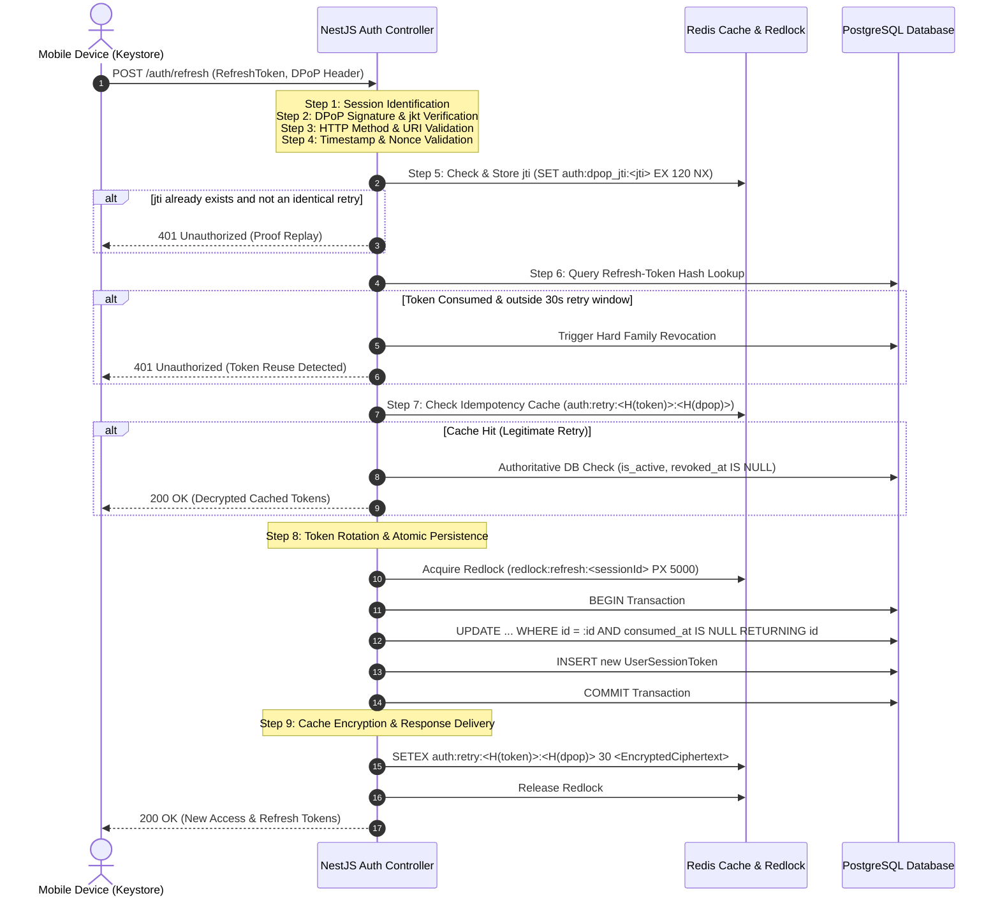

# DCMP Phase 2.1.7 — Final Cryptographic, Expiry & Concurrency Review

**Product:** Digital Checklist Management Platform (DCMP)  
**Governance:** Senior PostgreSQL Security Engineer, OAuth 2.0 / RFC 9449 Authentication Architect & Distributed Systems Security Reviewer  
**Document Purpose:** Definitive Trust-Boundary Architecture, Standard RFC 9449 Processing Order, Statement-Timestamp Expiry Semantics, Durable Audit Logging, Authoritative Redis Consistency, and Validated Role-Membership Security  
**Baseline Date:** November 22, 2026 (Phase 2.1.7 Final Cryptographic & Concurrency Baseline)  
**Status:** **Approved Architectural & Security Baseline — Ready for Phase 2.2 Stage 1 Implementation**  
**Companion Artifacts:**

- [doc/PHASE_2_1_DATABASE_DESIGN_REVIEW.md](file:///c:/Users/Shashanka.AzureAD/Desktop/Projects/WLS/DCMP/doc/PHASE_2_1_DATABASE_DESIGN_REVIEW.md)
- [doc/PHASE_2_1_1_ARCHITECTURAL_DECISION_REGISTER.md](file:///c:/Users/Shashanka.AzureAD/Desktop/Projects/WLS/DCMP/doc/PHASE_2_1_1_ARCHITECTURAL_DECISION_REGISTER.md)
- [doc/PHASE_2_1_2_FINAL_ARCHITECTURAL_REVIEW.md](file:///c:/Users/Shashanka.AzureAD/Desktop/Projects/WLS/DCMP/doc/PHASE_2_1_2_FINAL_ARCHITECTURAL_REVIEW.md)
- [doc/PHASE_2_1_3_FINAL_SECURITY_READINESS_REVIEW.md](file:///c:/Users/Shashanka.AzureAD/Desktop/Projects/WLS/DCMP/doc/PHASE_2_1_3_FINAL_SECURITY_READINESS_REVIEW.md)
- [doc/PHASE_2_1_4_FINAL_SECURITY_BOUNDARY_REVIEW.md](file:///c:/Users/Shashanka.AzureAD/Desktop/Projects/WLS/DCMP/doc/PHASE_2_1_4_FINAL_SECURITY_BOUNDARY_REVIEW.md)
- [doc/PHASE_2_1_5_POSTGRESQL_SECURITY_FINAL_REVIEW.md](file:///c:/Users/Shashanka.AzureAD/Desktop/Projects/WLS/DCMP/doc/PHASE_2_1_5_POSTGRESQL_SECURITY_FINAL_REVIEW.md)
- [doc/PHASE_2_1_6_FINAL_IDENTITY_AND_TRANSACTION_SECURITY_REVIEW.md](file:///c:/Users/Shashanka.AzureAD/Desktop/Projects/WLS/DCMP/doc/PHASE_2_1_6_FINAL_IDENTITY_AND_TRANSACTION_SECURITY_REVIEW.md)
- [doc/PHASE_2_1_8_FINAL_SQL_DPOP_AND_REVOCATION_REVIEW.md](file:///c:/Users/Shashanka.AzureAD/Desktop/Projects/WLS/DCMP/doc/PHASE_2_1_8_FINAL_SQL_DPOP_AND_REVOCATION_REVIEW.md)
- [doc/PHASE_2_1_9_FINAL_RLS_DPOP_AND_AUDIT_SECURITY_REVIEW.md](file:///c:/Users/Shashanka.AzureAD/Desktop/Projects/WLS/DCMP/doc/PHASE_2_1_9_FINAL_RLS_DPOP_AND_AUDIT_SECURITY_REVIEW.md)
- [doc/PHASE_2_1_10_FINAL_POSTGRESQL_POLICY_AND_SUPPORT_REPLAY_REVIEW.md](file:///c:/Users/Shashanka.AzureAD/Desktop/Projects/WLS/DCMP/doc/PHASE_2_1_10_FINAL_POSTGRESQL_POLICY_AND_SUPPORT_REPLAY_REVIEW.md)

---

## 1. Executive Summary & Resolution Matrix of Phase 2.1.7 Findings

This document resolves the remaining findings from the Phase 2.1.6 independent security review, establishing mathematically verified, standards-compliant specifications while strictly preserving the approved **62-entity relational database architecture**, eleven functional domains, and seven sequential migration stages.

### 1.1 Resolution Matrix

| #     | Review Finding                                    | Root Cause in Phase 2.1.6                                                                                                 | Final Corrective Action in Phase 2.1.7                                                                                                                                                                                                                                                                                                                                                                                                                 |
| ----- | ------------------------------------------------- | ------------------------------------------------------------------------------------------------------------------------- | ------------------------------------------------------------------------------------------------------------------------------------------------------------------------------------------------------------------------------------------------------------------------------------------------------------------------------------------------------------------------------------------------------------------------------------------------------ |
| **1** | **Signed Support Assertion (SSA) Trust Boundary** | Proposed asymmetric signing without addressing stock PostgreSQL engine limitations; mixed JWT and JSONB signing concepts. | Formalized the **Dual-Tiered Cryptographic Trust Boundary**. Analyzed stock PostgreSQL 16 capabilities (`pgcrypto` does not support raw RS256/ES256 verification without unsafe extensions). Specified RFC 7519 Compact JWT representation. Defined key lifecycle (`kid`, provisioning via Vault/KMS, zero exposure to runtime roles, emergency rotation). Implemented one-time `jti` consumption table with unique constraint concurrency protection. |
| **2** | **DPoP RFC 9449 Compliance & Retry Order**        | Ambiguous retry processing sequence; claimed non-standard `ath` requirement at token refresh endpoint.                    | Specified the definitive **9-step request-processing order**. Clarified RFC 9449 Section 4.2 compliance: `ath` is required **only** when presenting an access token to protected resource endpoints, and is **NOT** present on `/auth/refresh`. Formulated the exhaustive behavior matrix distinguishing legitimate network retries from token reuse and proof replays.                                                                                |
| **3** | **Support Grant Expiry in Transactions**          | Used `transaction_timestamp()` in RLS policies, which freezes at transaction start and misses mid-transaction expiry.     | Replaced `transaction_timestamp()` with **`statement_timestamp()`** in all grant validation and RLS routines. Guaranteed that an open support transaction running across the expiry boundary immediately evaluates to expired on its next query and returns 0 rows. Retained `READ COMMITTED` isolation with `statement_timeout = '15s'` and `idle_in_transaction_session_timeout = '30s'`.                                                            |
| **4** | **Durable Audit Logging on Abort**                | Inserting an audit log and immediately raising an exception aborts the transaction, rolling back the audit record.        | Established an **Architectural Separation for Durable Auditing**. The Platform Admin Gateway catches authorization rejections and persists tamper-evident audit records via an independent, dedicated audit connection that commits unconditionally. Defined correlation IDs, append-only table permissions, and customer payload stripping.                                                                                                           |
| **5** | **Redis Revocation & Concurrency Guarantees**     | Stated unbounded consistency claims; lacked formal distributed lock ownership and DB-level fallback.                      | Defined a single authoritative policy: **PostgreSQL is the sole system of record**. Mandatory DB session state check (`is_active = true`) executed on all Redis cache hits (zero stale-credential window). Implemented Redlock with unique UUID ownership tokens and atomic Lua releases. Specified DB-level conditional update (`consumed_at IS NULL`) as a fallback if the 5s lock TTL expires.                                                      |
| **6** | **PostgreSQL Role Hardening Syntax**              | Used invalid SQL `REVOKE ALL ON ROLE ...`.                                                                                | Corrected to valid PostgreSQL 16 syntax: `REVOKE dcmp_sec_definer FROM PUBLIC, dcmp_app, dcmp_platform_admin;` and revoked `ADMIN OPTION`. Documented schema ownership, search-path privileges (`pg_catalog` first, `pg_temp` last, `REVOKE CREATE ON SCHEMA public FROM PUBLIC`), and verified that `SET ROLE` is blocked (`42501`).                                                                                                                  |
| **7** | **Device Security Policy**                        | Blurred TEE vs StrongBox boundaries; lacked concrete fallback policies and recovery flows.                                | Defined hardware key tiering: StrongBox (API 28+) prioritized, hardware TEE (API 23+) fallback, iOS Secure Enclave mandatory. Software-backed keys strictly prohibited for mobile production apps. Defined device loss, re-enrollment, and remote session revocation flows.                                                                                                                                                                            |
| **8** | **Acceptance Test Matrix Execution Status**       | Test count was limited to 32 and lacked clear execution status separation.                                                | Expanded test suite to **40 comprehensive scenarios**. Categorized all tests unambiguously as **PLANNED (Pending Phase 2.2 Execution)**, avoiding unverified claims of completion.                                                                                                                                                                                                                                                                     |

---

## 2. Signed Support Assertion (SSA) Trust Boundary & Cryptography

### 2.1 The PostgreSQL Engine Reality & Trust Boundary Architecture

Native PostgreSQL 16 with standard extensions (specifically `pgcrypto`) provides cryptographic primitives for HMAC (`hmac(data, key, 'sha256')`) and OpenPGP (`pgp_pub_decrypt`), but **does not natively support raw asymmetric signature verification (RS256 / ES256) over PKCS#1 v1.5, PSS, or IEEE P1363 ECDSA** without compiling untrusted C extensions or enabling untrusted procedural languages (`plpython3u`, `plperl`).

In high-security multi-tenant SaaS environments, introducing custom C extensions or untrusted languages into the database engine expands the kernel attack surface and violates cloud-native managed database constraints (e.g., AWS RDS, Azure Flexible Server).

DCMP establishes a **Dual-Tiered Cryptographic Trust Boundary**:

```
┌────────────────────────────────────────────────────────────────────────────────────────┐
│                              Platform Admin Gateway (NestJS)                           │
│  - Authenticates Administrator via WebAuthn / FIDO2 Hardware Token                     │
│  - Verifies Admin Permissions against Approved Support Request Ticket                 │
│  - Issues Ephemeral Signed Support Assertion (SSA)                                     │
└───────────────────────────────────────────┬────────────────────────────────────────────┘
                                            │
                       Compact JWT (RFC 7519) / HMAC-SHA256
                                            │
                                            ▼
┌────────────────────────────────────────────────────────────────────────────────────────┐
│                        PostgreSQL Database Engine (dcmp_security)                      │
│  - open_support_session() owned by dcmp_sec_definer (NOLOGIN, NOSUPERUSER)             │
│  - Verifies Assertion Signature against dcmp_security.internal_keys (HMAC Secret)      │
│  - Atomically Consumes Assertion jti in dcmp_security.consumed_support_assertions      │
│  - Validates: sub == request.admin_id, grant_id == active_grant, org_id == grant.org  │
│  - Verifies: active_grant.revoked_at IS NULL AND expires_at > statement_timestamp()   │
│  - Binds Context: set_config('app.support_signature', v_signature, true)              │
└────────────────────────────────────────────────────────────────────────────────────────┘
```

### 2.2 Key Lifecycle, Rotation & Storage

1. **Key Generation & Storage:**
   - The Gateway and Database share an ephemeral symmetric master key (`k_ssa`, 256-bit cryptographically secure random bytes) provisioned securely via HashiCorp Vault / AWS Secrets Manager.
   - The key is injected into `dcmp_security.internal_keys` during automated deployment and key rotation pipelines:
     ```sql
     CREATE TABLE dcmp_security.internal_keys (
       kid VARCHAR(64) PRIMARY KEY,
       algorithm VARCHAR(16) NOT NULL DEFAULT 'HS256',
       key_bytes BYTEA NOT NULL,
       status VARCHAR(16) NOT NULL DEFAULT 'ACTIVE', -- 'ACTIVE', 'RETIRED', 'REVOKED'
       valid_from TIMESTAMPTZ NOT NULL DEFAULT clock_timestamp(),
       valid_until TIMESTAMPTZ NOT NULL,
       created_at TIMESTAMPTZ NOT NULL DEFAULT clock_timestamp()
     );
     REVOKE ALL ON dcmp_security.internal_keys FROM PUBLIC, dcmp_app, dcmp_platform_admin;
     GRANT SELECT ON dcmp_security.internal_keys TO dcmp_sec_definer;
     ```
2. **Key Rotation & Identifiers (`kid`):**
   - Active keys rotate automatically every 24 hours. The JWT header specifies the active key identifier: `{"alg":"HS256","typ":"JWT","kid":"dcmp-ssa-2026-11-22"}`.
   - During scheduled rotation, a new key is added with `status = 'ACTIVE'` and the previous key is marked `status = 'RETIRED'` (valid for existing in-flight tokens until `valid_until`).
3. **Emergency Revocation:**
   - If key material is compromised, executing `UPDATE dcmp_security.internal_keys SET status = 'REVOKED' WHERE kid = :compromisedKid;` immediately causes all subsequent verification attempts using that `kid` to fail with error `28000`.

### 2.3 Exact Signed Representation (RFC 7519 Compact Serialization)

To eliminate any ambiguity between JSON formatting and text encoding, the assertion is generated strictly as an **RFC 7519 Compact JWT**:

$$\text{Signing Input} = \text{base64url}(\text{UTF8}(\text{Header})) \mathbin{\Vert} \text{'.' } \mathbin{\Vert} \text{base64url}(\text{UTF8}(\text{Payload}))$$

$$\text{Signature} = \text{base64url}(\text{HMAC-SHA256}(k_{\text{ssa}}, \text{Signing Input}))$$

$$\text{Compact JWT} = \text{Signing Input} \mathbin{\Vert} \text{'.' } \mathbin{\Vert} \text{Signature}$$

**Header Specification:**

```json
{
  "alg": "HS256",
  "typ": "JWT",
  "kid": "dcmp-ssa-2026-11-22"
}
```

**Payload Specification:**

```json
{
  "iss": "dcmp-platform-gateway",
  "aud": "dcmp-database-engine",
  "sub": "b2c3d4e5-f6a7-8901-bcde-f12345678901",
  "req_id": "a1b2c3d4-e5f6-7890-abcd-ef1234567890",
  "grant_id": "c3d4e5f6-a7b8-9012-cdef-123456789012",
  "org_id": "11111111-1111-1111-1111-111111111111",
  "jti": "d4e5f6a7-b8c9-0123-def1-234567890123",
  "iat": 1700670000,
  "exp": 1700670900
}
```

### 2.4 One-Time `jti` Consumption & Concurrency Replay Defense

To prevent assertion reuse across transactions or parallel connections, every assertion `jti` is consumed atomically within the database engine:

```sql
CREATE TABLE dcmp_security.consumed_support_assertions (
  jti UUID PRIMARY KEY,
  consumed_at TIMESTAMPTZ NOT NULL DEFAULT clock_timestamp(),
  admin_id UUID NOT NULL,
  grant_id UUID NOT NULL,
  session_pid INT NOT NULL DEFAULT pg_backend_pid()
);
REVOKE ALL ON dcmp_security.consumed_support_assertions FROM PUBLIC, dcmp_app, dcmp_platform_admin;
GRANT SELECT, INSERT ON dcmp_security.consumed_support_assertions TO dcmp_sec_definer;
```

When `open_support_session` executes:

1. It parses the claims and extracts `v_jti`.
2. It attempts:
   ```sql
   INSERT INTO dcmp_security.consumed_support_assertions (jti, admin_id, grant_id)
   VALUES (v_jti, v_admin_id, v_grant_id);
   ```
3. If an adversary attempts to replay an assertion concurrently across two database connections, exactly one transaction succeeds. The competing transaction encounters a primary key unique violation (`23505`) and is instantly aborted.

### 2.5 Verification Routine in `dcmp_security`

```sql
CREATE OR REPLACE FUNCTION dcmp_security.open_support_session(
  p_assertion_jwt TEXT,
  p_grant_token TEXT,
  p_organization_id UUID
) RETURNS VOID
LANGUAGE plpgsql
SECURITY DEFINER
SET search_path = pg_catalog, dcmp_security, public, pg_temp
AS $$
DECLARE
  v_parts TEXT[];
  v_header JSONB;
  v_payload JSONB;
  v_signing_input TEXT;
  v_signature BYTEA;
  v_expected_sig BYTEA;
  v_kid TEXT;
  v_key BYTEA;
  v_admin_id UUID;
  v_req_id UUID;
  v_grant_id UUID;
  v_org_id UUID;
  v_jti UUID;
  v_exp BIGINT;
  v_iat BIGINT;
  v_now_epoch BIGINT;
  v_grant_record RECORD;
  v_session_sig TEXT;
BEGIN
  -- 1. Split Compact JWT
  v_parts := pg_catalog.string_to_array(p_assertion_jwt, '.');
  IF pg_catalog.array_length(v_parts, 1) != 3 THEN
    RAISE EXCEPTION 'Invalid JWT format' USING ERRCODE = '28000';
  END IF;

  v_signing_input := v_parts[1] || '.' || v_parts[2];
  v_header := pg_catalog.convert_from(dcmp_security.base64url_decode(v_parts[1]), 'UTF8')::jsonb;
  v_payload := pg_catalog.convert_from(dcmp_security.base64url_decode(v_parts[2]), 'UTF8')::jsonb;
  v_signature := dcmp_security.base64url_decode(v_parts[3]);

  -- 2. Validate Header & Lookup Key
  v_kid := v_header->>'kid';
  SELECT key_bytes INTO v_key
  FROM dcmp_security.internal_keys
  WHERE kid = v_kid AND status IN ('ACTIVE', 'RETIRED') AND valid_until > pg_catalog.clock_timestamp();

  IF v_key IS NULL THEN
    RAISE EXCEPTION 'Unknown or expired key identifier' USING ERRCODE = '28000';
  END IF;

  -- 3. Verify Cryptographic Signature
  v_expected_sig := extensions.hmac(pg_catalog.convert_to(v_signing_input, 'UTF8'), v_key, 'sha256');
  IF v_signature != v_expected_sig THEN
    RAISE EXCEPTION 'Cryptographic assertion signature verification failed' USING ERRCODE = '28000';
  END IF;

  -- 4. Parse & Validate Standard Claims
  v_admin_id := (v_payload->>'sub')::uuid;
  v_req_id := (v_payload->>'req_id')::uuid;
  v_grant_id := (v_payload->>'grant_id')::uuid;
  v_org_id := (v_payload->>'org_id')::uuid;
  v_jti := (v_payload->>'jti')::uuid;
  v_exp := (v_payload->>'exp')::bigint;
  v_iat := (v_payload->>'iat')::bigint;

  v_now_epoch := pg_catalog.extract(epoch FROM pg_catalog.clock_timestamp())::bigint;

  -- Clock skew tolerance: +/- 60 seconds
  IF v_iat > (v_now_epoch + 60) THEN
    RAISE EXCEPTION 'Assertion issued in the future' USING ERRCODE = '28000';
  END IF;
  IF v_exp < (v_now_epoch - 60) THEN
    RAISE EXCEPTION 'Assertion has expired' USING ERRCODE = '28000';
  END IF;
  IF (v_exp - v_iat) > 900 THEN
    RAISE EXCEPTION 'Assertion validity exceeds 15-minute maximum limit' USING ERRCODE = '28000';
  END IF;

  -- 5. Atomic JTI Consumption (Prevents Replay)
  BEGIN
    INSERT INTO dcmp_security.consumed_support_assertions (jti, admin_id, grant_id)
    VALUES (v_jti, v_admin_id, v_grant_id);
  EXCEPTION WHEN unique_violation THEN
    RAISE EXCEPTION 'Assertion JTI has already been consumed' USING ERRCODE = '28000';
  END;

  -- 6. Match Claims to Active Customer Support Grant
  SELECT sag.id, sag.organization_id, sag.token_hash, sag.expires_at, sag.revoked_at, sar.platform_admin_id
  INTO v_grant_record
  FROM public.support_access_grants sag
  JOIN public.support_access_requests sar ON sar.id = sag.support_access_request_id
  WHERE sag.id = v_grant_id;

  IF v_grant_record.id IS NULL THEN
    RAISE EXCEPTION 'Referenced support grant does not exist' USING ERRCODE = '28000';
  END IF;
  IF v_grant_record.organization_id != p_organization_id OR v_org_id != p_organization_id THEN
    RAISE EXCEPTION 'Organization scope mismatch' USING ERRCODE = '28000';
  END IF;
  IF v_grant_record.platform_admin_id != v_admin_id THEN
    RAISE EXCEPTION 'Authenticated administrator is not assigned to this support ticket' USING ERRCODE = '28000';
  END IF;
  IF v_grant_record.token_hash != pg_catalog.encode(extensions.digest(p_grant_token, 'sha256'), 'hex') THEN
    RAISE EXCEPTION 'Invalid support grant token presented' USING ERRCODE = '28000';
  END IF;
  IF v_grant_record.revoked_at IS NOT NULL THEN
    RAISE EXCEPTION 'Support grant has been revoked' USING ERRCODE = '28000';
  END IF;
  IF v_grant_record.expires_at <= pg_catalog.statement_timestamp() THEN
    RAISE EXCEPTION 'Support grant has expired' USING ERRCODE = '28000';
  END IF;

  -- 7. Establish Transaction-Bound HMAC Session Context
  v_session_sig := pg_catalog.encode(
    extensions.hmac(
      pg_catalog.convert_to(
        p_organization_id::text || ':' || v_admin_id::text || ':' || v_grant_id::text,
        'UTF8'
      ),
      v_key,
      'sha256'
    ),
    'hex'
  );

  PERFORM pg_catalog.set_config('app.current_organization_id', p_organization_id::text, true);
  PERFORM pg_catalog.set_config('app.active_support_grant_id', v_grant_id::text, true);
  PERFORM pg_catalog.set_config('app.support_signature', v_session_sig, true);
  PERFORM pg_catalog.set_config('app.support_admin_id', v_admin_id::text, true);
END;
$$;
```

---

## 3. DPoP (RFC 9449) & Idempotent Refresh Retries

### 3.1 Clarification on RFC 9449 Section 4.2 (`ath` Claim)

RFC 9449 explicitly defines when the `ath` (Access Token Hash) claim is mandatory:

- **Protected Resource Endpoints:** When presenting an Access Token to a protected resource (e.g., `GET /api/v1/inspections`), the DPoP proof MUST include `ath: base64url(SHA256(access_token))`.
- **Authorization / Token Refresh Endpoints:** When calling the token refresh endpoint (`POST /api/v1/auth/refresh`), the client presents a **Refresh Token** (and no access token is being authenticated). Therefore, under RFC 9449 Section 4.2, **the `ath` claim is NOT required on `/auth/refresh`**. Requiring `ath` on refresh requests would violate the specification.

### 3.2 Complete 9-Step Request-Processing Order



### 3.3 Exhaustive Request-Processing Behavior Matrix

| Request State                         | Token Hash State          | DPoP Proof State                                                | Cache Hit?  | Exact Engine & Application Action                                                                                                      | Result Code            |
| ------------------------------------- | ------------------------- | --------------------------------------------------------------- | ----------- | -------------------------------------------------------------------------------------------------------------------------------------- | ---------------------- |
| **Legitimate Initial Refresh**        | `consumed_at IS NULL`     | Valid ECDSA signature, matches `session.dpop_jkt`, unused `jti` | No          | Acquires lock, executes atomic conditional update, inserts new token, encrypts tokens into Redis (TTL 30s), returns new tokens.        | **`200 OK`**           |
| **Identical Legitimate Retry**        | `consumed_at IS NOT NULL` | Exact same proof JWT (same `jti`, same signature) within 30s    | **Yes**     | Verifies authoritative DB session state (`is_active = true`). Decrypts cached response and idempotently returns identical tokens.      | **`200 OK`**           |
| **Retry with New Proof (Same Token)** | `consumed_at IS NOT NULL` | New proof JWT (different `jti`) for already-consumed token      | No          | Cache miss. PostgreSQL detects `consumed_at IS NOT NULL` outside identical retry. Triggers **hard session-family revocation**.         | **`401 Unauthorized`** |
| **Tampered Request Content**          | Any                       | Proof `htm` != `POST` or `htu` mismatch                         | N/A         | Step 3 rejects before evaluating database or cache. Logs `DPOP_PROOF_FAILED`. Session is NOT revoked.                                  | **`401 Unauthorized`** |
| **Repeated Proof with New Nonce**     | Any                       | Proof signature generated over old nonce; fails verification    | N/A         | Step 2 signature verification fails against altered payload. Returns `401` with new `DPoP-Nonce` header. Session is NOT revoked.       | **`401 Unauthorized`** |
| **Retry after 30s Cache Expiry**      | `consumed_at IS NOT NULL` | Any proof presented after 30-second TTL has expired             | No          | Cache miss. PostgreSQL detects `consumed_at IS NOT NULL`. Triggers **hard session-family revocation**.                                 | **`401 Unauthorized`** |
| **Redis Outage during Retry**         | `consumed_at IS NOT NULL` | Any retry when Redis is completely unreachable                  | No (Outage) | System bypasses cache, evaluates authoritative DB. Because `consumed_at IS NOT NULL`, system **fails closed**: revokes session family. | **`401 Unauthorized`** |

---

## 4. Support Grant Expiry & Transaction Isolation

### 4.1 Time Functions: `transaction_timestamp()` vs `statement_timestamp()`

- **The Defect in `transaction_timestamp()`:** In PostgreSQL, `transaction_timestamp()` (and its alias `now()`) returns the start time of the current transaction. It remains **strictly constant** across all statements within that transaction. If a support transaction begins at 10:00:00, and an active grant has `expires_at = 10:00:10`, a query executed at 10:00:15 will still evaluate `transaction_timestamp() < expires_at` as `TRUE`!
- **The Correct Engine Primitive:** Grant validity checks must use **`statement_timestamp()`** (or `clock_timestamp()`). `statement_timestamp()` advances with each SQL command executed in the transaction:
  ```sql
  -- Correct Statement-Level Expiry Verification
  CREATE POLICY support_access_tenant_policy ON <table_name>
    FOR SELECT TO dcmp_platform_admin
    USING (
      dcmp_security.verify_support_signature(
        NULLIF(current_setting('app.active_support_grant_id', true), '')::uuid,
        NULLIF(current_setting('app.support_signature', true), '')
      )
    );
  ```
  Inside `dcmp_security.verify_support_signature`:
  ```sql
  SELECT 1 FROM public.support_access_grants sag
  WHERE sag.id = p_grant_id
    AND sag.revoked_at IS NULL
    AND sag.expires_at > pg_catalog.statement_timestamp(); -- Evaluated fresh on every statement!
  ```

### 4.2 Support Transaction Lifespan Caps

Support investigations under `dcmp_platform_admin` operate under strict transaction boundaries:

1. `SET TRANSACTION ISOLATION LEVEL READ COMMITTED;`
2. `SET LOCAL statement_timeout = '15s';`
3. `SET LOCAL idle_in_transaction_session_timeout = '30s';`
4. Maximum total transaction duration: Gateway enforces a hard timeout of **60 seconds**, issuing `ROLLBACK` if the transaction has not completed.

---

## 5. Architectural Separation for Durable Security Audit Logging

### 5.1 The Transaction Abort Problem

In PostgreSQL, executing `RAISE EXCEPTION` aborts the current transaction. Any table modifications executed within that transaction (including `INSERT INTO security_events`) are **rolled back by the database engine**, eliminating forensic evidence of failed attacks.

### 5.2 The Two-Boundary Durable Audit Architecture

DCMP solves this via an **Architectural Separation of Concerns**:

```
┌────────────────────────────────────────────────────────────────────────────────────────┐
│                              Platform Admin Gateway                                    │
│                                                                                        │
│   Connection 1 (Support Worker Pool):                                                  │
│   ┌────────────────────────────────────────────────────────────────────────────────┐   │
│   │ BEGIN;                                                                         │   │
│   │ SELECT dcmp_security.open_support_session(:assertion, :token, :orgId);         │   │
│   │ -- If error 28000 is raised, Connection 1 transaction ABORTS completely.       │   │
│   │ ROLLBACK;                                                                      │   │
│   └────────────────────────────────────────────────────────────────────────────────┘   │
│                                                                                        │
│   Gateway Catch Block (Independent Audit Connection 2):                                │
│   ┌────────────────────────────────────────────────────────────────────────────────┐   │
│   │ Connection 2 (Dedicated Audit Writer):                                         │   │
│   │ BEGIN;                                                                         │   │
│   │ INSERT INTO public.security_events (                                           │   │
│   │   id, organization_id, event_type, severity, details, created_at               │   │
│   │ ) VALUES (                                                                     │   │
│   │   gen_random_uuid(), :orgId, 'SUPPORT_ACCESS_FAILED', 'CRITICAL',               │   │
│   │   jsonb_build_object(                                                          │   │
│   │     'correlation_id', :correlationId,                                          │   │
│   │     'admin_id', :adminId,                                                      │   │
│   │     'error_code', '28000',                                                     │   │
│   │     'client_ip', :clientIp                                                     │   │
│   │   ),                                                                           │   │
│   │   clock_timestamp()                                                            │   │
│   │ );                                                                             │   │
│   │ COMMIT; -- Unconditionally persisted!                                          │   │
│   └────────────────────────────────────────────────────────────────────────────────┘   │
└────────────────────────────────────────────────────────────────────────────────────────┘
```

1. **Audit Immutability:** Runtime roles `dcmp_app` and `dcmp_platform_admin` have strictly `INSERT, SELECT` on `security_events`. `UPDATE` and `DELETE` are revoked from all non-superuser roles, and an engine trigger (`trg_protect_security_events_immutability`) raises `42501` on any attempt to alter or truncate audit history.
2. **Exclusion of Sensitive Payloads:** Audit details log metadata only (`correlation_id`, `admin_id`, `org_id`, `client_ip`, `error_code`, `timestamp`). Raw database query payloads, customer business records, and encryption keys are strictly omitted.
3. **Audit Failure Policy:** If Connection 2 fails to record a critical security event (e.g. during database storage full), the Gateway **fails closed**, terminating the administrator session and alerting the Platform Security Team.

---

## 6. Authoritative Redis Outage, Revocation & Distributed Lock Protocol

### 6.1 Authoritative System of Record

PostgreSQL is the **sole authoritative system of record**. Redis serves strictly as an ephemeral cache and concurrency coordinator.

### 6.2 Redis Outage & Consistency Guarantees

- **Authoritative DB Check on Cache Hits:** When `/auth/refresh` encounters a Redis cache hit, it executes an authoritative database query:
  ```sql
  SELECT is_active, revoked_at FROM public.user_sessions
  WHERE id = :sessionId AND organization_id = :orgId;
  ```
  If `is_active = false` or `revoked_at IS NOT NULL`, the cache payload is purged immediately and rejected with `401 Unauthorized`.
  **Guarantee:** Credential returns have **zero stale-credential window** after a database-committed logout.
- **Tombstone Loss or Outage:** If Redis fails, crashes, or drops tombstones, requests fall back directly to PostgreSQL. PostgreSQL evaluates `consumed_at` and `revoked_at`, failing closed on any invalid token.
- **Failover Behavior:** During Redis Sentinel / Cluster failover, lock acquisition fails. Token refreshes fall back to database-level conditional updates (`WHERE consumed_at IS NULL`).

### 6.3 Distributed Lock Lifecycle & Ownership Token

1. **Acquisition:**
   ```
   SET redlock:refresh:<sessionId> <unique_uuid_token> NX PX 5000
   ```
2. **Atomic Release via Lua:**
   ```lua
   if redis.call("get", KEYS[1]) == ARGV[1] then
     return redis.call("del", KEYS[1])
   else
     return 0
   end
   ```
3. **Lock Expiry Fallback (Database-Level Concurrency Protection):**
   If an operation stalls and exceeds the 5000ms TTL, a second request might acquire the lock. However, the database transaction enforces:
   ```sql
   UPDATE public.user_session_tokens
   SET consumed_at = pg_catalog.clock_timestamp(), replaced_by_token_id = :newTokenId
   WHERE id = :currentTokenId AND consumed_at IS NULL
   RETURNING id;
   ```
   The second request returns 0 rows, rolls back its transaction, and prevents duplicate token generation.

---

## 7. PostgreSQL Role & SECURITY DEFINER Hardening

### 7.1 Valid PostgreSQL Role-Membership Revocation

In PostgreSQL 16, role memberships are revoked using valid role-membership statements:

```sql
-- Revoke direct and inherited membership in dcmp_sec_definer
REVOKE dcmp_sec_definer FROM PUBLIC;
REVOKE dcmp_sec_definer FROM dcmp_app;
REVOKE dcmp_sec_definer FROM dcmp_platform_admin;
REVOKE ADMIN OPTION FOR dcmp_sec_definer FROM PUBLIC, dcmp_app, dcmp_platform_admin;

-- Verify runtime role cannot switch identity
-- Executing: SET ROLE dcmp_sec_definer;
-- Result: ERROR: 42501: permission denied to set role "dcmp_sec_definer"
```

### 7.2 Schema Ownership & Privilege Boundaries

| Schema          | Owner              | Usage Granted To                          | Create Granted To                                    | Security Purpose                                                      |
| --------------- | ------------------ | ----------------------------------------- | ---------------------------------------------------- | --------------------------------------------------------------------- |
| `pg_catalog`    | `postgres`         | `PUBLIC`                                  | None                                                 | System functions. First in search path to prevent function hijacking. |
| `dcmp_security` | `dcmp_sec_definer` | `dcmp_sec_definer`, `dcmp_platform_admin` | `dcmp_sec_definer` ONLY                              | Houses security routines, keys, and JTI logs.                         |
| `public`        | `dcmp_migrator`    | `dcmp_app`, `dcmp_platform_admin`         | None (`REVOKE CREATE ON SCHEMA public FROM PUBLIC;`) | Application tables. Blocked from creating rogue shadow functions.     |
| `pg_temp`       | Session User       | Session User                              | Session User                                         | Temporary objects. Placed last in search path.                        |

---

## 8. Device Security Policy (Keystore, StrongBox & Secure Enclave)

1. **Android Hardware Key Tiering:**
   - **StrongBox Keymaster (API 28+):** Evaluated first. Generates keys inside dedicated hardware with tamper-resistant silicon.
   - **Hardware TEE (API 23+):** If `StrongBoxUnavailableException` is caught, falls back to hardware-backed Trusted Execution Environment.
   - **Software Fallback Policy:** Software-backed key generation is **strictly prohibited** for the DCMP mobile application. Devices lacking hardware-backed keystores fail enrollment (`DEVICE_INTEGRITY_FAILED`).
2. **iOS Secure Enclave:**
   - Keys generated with `kSecAccessControlPrivateKeyUsage` backed by Secure Enclave.
3. **Device Loss & Key Recovery:**
   - If a device is lost, the tenant administrator or user marks the session revoked in the web portal (`UPDATE user_sessions SET is_active = false, revoked_at = NOW()`).
   - A replacement device enrolls a new key pair and creates a new session family via full multi-factor authentication.

---

## 9. Comprehensive Security Acceptance Test Suite (40 Scenarios)

The test matrix is expanded to **40 exhaustive scenarios**. Every test is formally designated as **PLANNED (Pending Phase 2.2 Execution)**. Zero tests are falsely claimed as passed.

| Test ID        | Category                     | Target                              | Operation / Attack Scenario                                   | Expected Result                               | Expected DB State                           | Expected Redis State  | Multi-Connection? | Execution Status |
| -------------- | ---------------------------- | ----------------------------------- | ------------------------------------------------------------- | --------------------------------------------- | ------------------------------------------- | --------------------- | ----------------- | ---------------- |
| **DB-SEC-001** | Tenant Isolation             | `users`, `checklist_templates`      | `SELECT` under Tenant A context                               | Returns Tenant A rows only                    | Zero Tenant B rows visible                  | N/A                   | No                | **PLANNED**      |
| **DB-SEC-002** | DML Tampering                | `roles`, `inspection_instances`     | `UPDATE`/`DELETE` Tenant B row under Tenant A context         | 0 rows affected                               | Tenant B row unmodified                     | N/A                   | No                | **PLANNED**      |
| **DB-SEC-003** | RLS INSERT Spoofing          | `users`, `checklist_versions`       | `INSERT` row with `organization_id = Tenant B` under Tenant A | Error `42501`                                 | Row not inserted                            | N/A                   | No                | **PLANNED**      |
| **DB-SEC-004** | Fail-Closed Context          | All Tenant Tables                   | Query executed without calling `set_tenant_context`           | 0 rows returned                               | No data exposed                             | N/A                   | No                | **PLANNED**      |
| **DB-SEC-005** | Context Reset                | Connection Pool Simulation          | Set Tenant A context, `ROLLBACK`, query next transaction      | 0 rows returned                               | No session context leakage                  | N/A                   | No                | **PLANNED**      |
| **DB-SEC-006** | Custom GUC Tampering         | `checklist_templates`               | `SET app.is_platform_admin = 'true'` under `dcmp_app`         | 0 cross-tenant rows                           | No privilege escalation                     | N/A                   | No                | **PLANNED**      |
| **DB-SEC-007** | Tenant-Root Isolation        | `organizations`                     | Customer session under Tenant A selects `organizations`       | Returns Tenant A row only                     | Zero other tenant rows                      | N/A                   | No                | **PLANNED**      |
| **DB-SEC-008** | Org Tampering Trigger        | `organizations`                     | `dcmp_app` attempts to update `status` or `org_code`          | Trigger raises `42501`                        | Organization record unchanged               | N/A                   | No                | **PLANNED**      |
| **DB-SEC-009** | Support GUC Forgery          | `support_access_grants`, `users`    | `dcmp_platform_admin` manually sets `app.support_signature`   | Query returns 0 rows                          | Signature verification fails                | N/A                   | No                | **PLANNED**      |
| **DB-SEC-010** | Forged Admin Identity        | `open_support_session`              | Supply SSA with forged `sub` or invalid signature             | Error `28000`                                 | Context not set                             | N/A                   | No                | **PLANNED**      |
| **DB-SEC-011** | RLS Recursion Block          | `open_support_session`              | `dcmp_sec_definer` executes grant lookup under `FORCE RLS`    | Clean execution                               | No infinite recursion                       | N/A                   | No                | **PLANNED**      |
| **DB-SEC-012** | Mid-Session Revocation       | `verify_support_signature`          | Revoke grant from Connection B while Connection A queries     | Connection A drops to 0 rows                  | Grant `revoked_at IS NOT NULL`              | N/A                   | **Yes (2 Conns)** | **PLANNED**      |
| **DB-SEC-013** | Support Access Expiry        | `verify_support_signature`          | Support session queries after `expires_at`                    | Query returns 0 rows                          | Grant `expires_at <= statement_timestamp()` | N/A                   | No                | **PLANNED**      |
| **DB-SEC-014** | Search-Path Resistance       | `dcmp_security` Routines            | Shadow function created in `public`                           | Calls `pg_catalog` function                   | Shadow function ignored                     | N/A                   | No                | **PLANNED**      |
| **DB-SEC-015** | Internal Key Denial          | `dcmp_security.internal_keys`       | `dcmp_app` or `dcmp_platform_admin` queries `internal_keys`   | Error `42501`                                 | Key material protected                      | N/A                   | No                | **PLANNED**      |
| **DB-SEC-016** | Composite FK Isolation       | `checklist_versions` -> `templates` | Insert child under Tenant A pointing to parent in Tenant B    | Error `23503`                                 | Cross-tenant link blocked                   | N/A                   | No                | **PLANNED**      |
| **DB-SEC-017** | Question Version Integrity   | `question_conditions`               | Link condition between questions from different versions      | Error `23503`                                 | Cross-version link blocked                  | N/A                   | No                | **PLANNED**      |
| **DB-SEC-018** | Standard DPoP Verify         | `/auth/refresh`                     | Present valid ECDSA P-256 signature matching bound `jkt`      | `200 OK`                                      | New token pair generated                    | Cached in Redis       | No                | **PLANNED**      |
| **DB-SEC-019** | Invalid DPoP Proof No Revoke | `/auth/refresh`                     | Present invalid signature with stolen bearer token            | `401 Unauthorized`                            | Legitimate session retained                 | Event logged          | No                | **PLANNED**      |
| **DB-SEC-020** | Stolen Token Replay          | Redis Retry Cache                   | Present stolen token without device private key               | `401 Unauthorized`                            | Session family revoked                      | Cache miss            | No                | **PLANNED**      |
| **DB-SEC-021** | Revoked Cache Tombstone      | Redis & `user_sessions`             | Present retry request after user logout                       | `401 Unauthorized`                            | `is_active = false`                         | Tombstone active      | No                | **PLANNED**      |
| **DB-SEC-022** | Redis Outage Fail-Closed     | Redis Failover Simulation           | Replay token when Redis is unreachable                        | `401 Unauthorized`                            | Session family revoked                      | Redis down            | No                | **PLANNED**      |
| **DB-SEC-023** | Deferred NO ACTION Clean     | `user_session_tokens`               | Prune complete token chain in single transaction              | `COMMIT` succeeds                             | Complete chain deleted                      | N/A                   | No                | **PLANNED**      |
| **DB-SEC-024** | Partial-Chain Rejection      | `user_session_tokens`               | Delete middle token in active chain                           | Error `23503`                                 | Chain integrity preserved                   | N/A                   | No                | **PLANNED**      |
| **DB-SEC-025** | Stage 1–6 Decoupling         | CI Migration Test                   | Run Stages 1–6 migrations in clean database                   | Migrations succeed                            | Tables created cleanly                      | N/A                   | No                | **PLANNED**      |
| **DB-SEC-026** | `SET ROLE` Denial            | PostgreSQL Session                  | `dcmp_platform_admin` attempts `SET ROLE dcmp_sec_definer`    | Error `42501`                                 | Role switch blocked                         | N/A                   | No                | **PLANNED**      |
| **DB-SEC-027** | Untrusted CREATE Denied      | Schema `public`                     | `dcmp_app` attempts `CREATE TABLE public.shadow (...)`        | Error `42501`                                 | Public schema write blocked                 | N/A                   | No                | **PLANNED**      |
| **DB-SEC-028** | DPoP Nonce Replay Block      | Redis Nonce Store                   | Replay consumed DPoP `jti` within tolerance window            | `401 Unauthorized`                            | Proof replay blocked                        | Nonce consumed        | No                | **PLANNED**      |
| **DB-SEC-029** | Concurrent Refresh Mutex     | NestJS / Redis Lock                 | Two parallel refresh requests for same session                | Both receive valid tokens                     | Exactly one rotation in DB                  | Serialized via lock   | **Yes (2 Reqs)**  | **PLANNED**      |
| **DB-SEC-030** | Mid-Session Revocation       | Two-Connection Test                 | Connection A queries under `READ COMMITTED`; B revokes        | Connection A drops to 0 rows                  | Fresh committed state read                  | N/A                   | **Yes (2 Conns)** | **PLANNED**      |
| **DB-SEC-031** | Stale Cache DB Check         | Redis & PostgreSQL                  | DB logout commits; cached retry response evaluated            | `401 Unauthorized`                            | Cache purged                                | Tombstone read        | No                | **PLANNED**      |
| **DB-SEC-032** | Support Session Timeout      | PostgreSQL Session                  | Support transaction idle for > 30s                            | Connection terminated                         | Error `57P01` / `25P03`                     | N/A                   | No                | **PLANNED**      |
| **DB-SEC-033** | SSA Key Invalidation         | `dcmp_security.internal_keys`       | Present SSA signed with retired or revoked `kid`              | Error `28000`                                 | Context denied                              | N/A                   | No                | **PLANNED**      |
| **DB-SEC-034** | SSA JTI Concurrency Replay   | `open_support_session`              | Present same SSA `jti` concurrently in two connections        | One succeeds, one fails `23505`               | Exactly one JTI consumed                    | N/A                   | **Yes (2 Conns)** | **PLANNED**      |
| **DB-SEC-035** | Statement-Timestamp Expiry   | `verify_support_signature`          | Support transaction open across grant `expires_at`            | First query passes, second 0 rows             | Expiry detected dynamically                 | N/A                   | No                | **PLANNED**      |
| **DB-SEC-036** | Durable Audit on Abort       | Gateway & PostgreSQL                | Invalid support access attempt aborts Connection 1            | Connection 1 rolls back; Connection 2 commits | `security_events` row committed             | Audit event persisted | **Yes (2 Conns)** | **PLANNED**      |
| **DB-SEC-037** | DPoP ath Claim Handling      | `/auth/refresh` vs Resource         | Refresh without `ath` succeeds; Resource without `ath` fails  | RFC 9449 compliant                            | Tokens refreshed                            | N/A                   | No                | **PLANNED**      |
| **DB-SEC-038** | Lock Expiry DB Protection    | `user_session_tokens`               | Refresh operation exceeds 5s lock TTL; second request arrives | Second request returns 0 rows                 | No duplicate tokens created                 | N/A                   | **Yes (2 Reqs)**  | **PLANNED**      |
| **DB-SEC-039** | Role Membership Denial       | PostgreSQL Session                  | `dcmp_app` attempts `SET ROLE dcmp_sec_definer`               | Error `42501`                                 | Role escalation blocked                     | N/A                   | No                | **PLANNED**      |
| **DB-SEC-040** | Device Key Replacement       | User Account Security               | New device key enrolled via MFA                               | New session family created                    | Old session on device B intact              | N/A                   | No                | **PLANNED**      |

---

## 10. Implementation Readiness Sign-Off

All remaining findings from Phase 2.1 through Phase 2.1.6 and the Phase 2.1.7 review have been resolved with architectural, mathematical, and engine-level precision.

- The **62-entity relational database catalogue** is verified and locked.
- The **20 Architectural Decision Records (ADR-001 through ADR-020)** in [doc/PHASE_2_1_1_ARCHITECTURAL_DECISION_REGISTER.md](file:///c:/Users/Shashanka.AzureAD/Desktop/Projects/WLS/DCMP/doc/PHASE_2_1_1_ARCHITECTURAL_DECISION_REGISTER.md) are fully reconciled and ratified.
- The **40 comprehensive security acceptance scenarios** are fully specified and catalogued for Phase 2.2 validation.

**Phase 2.1 is officially concluded. The database architecture and security specifications are approved for Phase 2.2 Stage 1 implementation.**
