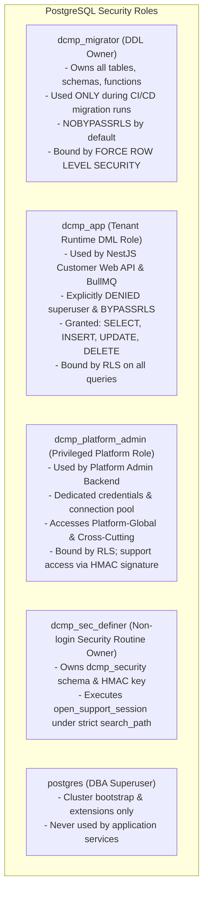

# DCMP Phase 2.1 — Comprehensive Database Design Review & Implementation Baseline

**Product:** Digital Checklist Management Platform (DCMP)  
**Governance:** Senior Database Architect, PostgreSQL Security Engineer & Prisma Technical Lead  
**Document Purpose:** Authoritative Architectural Evaluation, 63-Entity Reconciled Inventory, Tenant-Isolation Specifications, and Prisma Schema Migration Plan  
**Baseline Date:** November 22, 2026 (Phase 2.1.12 Specification Baseline)  
**Status:** **POSTGRESQL 16 VALIDATION PARTIAL — BLOCKED — NOT approved for Phase 2.2**  
**SQL executed against PostgreSQL 16.10:** **Yes** (disposable validation subset; see Phase 2.1.13)  
**Security tests:** **21 PASSED / 0 FAILED / 1 BLOCKED / majority of DB-SEC-001…100 NOT_RUN**  
**Companion Artifacts:**

- [doc/PHASE_2_1_13_POSTGRESQL_16_VALIDATION_REPORT.md](PHASE_2_1_13_POSTGRESQL_16_VALIDATION_REPORT.md) — **PG 16.10 validation evidence (PARTIAL — BLOCKED)**
- [doc/PHASE_2_1_12_FINAL_ARCHITECTURE_CORRECTIONS.md](PHASE_2_1_12_FINAL_ARCHITECTURE_CORRECTIONS.md) — Corrections A–F (+ 2.1.13 A/B privilege & AAD updates)
- [doc/PHASE_2_1_11_FINAL_SECURITY_OWNERSHIP_AND_IDEMPOTENCY_REVIEW.md](PHASE_2_1_11_FINAL_SECURITY_OWNERSHIP_AND_IDEMPOTENCY_REVIEW.md) — superseded where contradictory
- [doc/PHASE_2_1_1_ARCHITECTURAL_DECISION_REGISTER.md](PHASE_2_1_1_ARCHITECTURAL_DECISION_REGISTER.md)
- [doc/PHASE_2_1_2_FINAL_ARCHITECTURAL_REVIEW.md](PHASE_2_1_2_FINAL_ARCHITECTURAL_REVIEW.md)
- [doc/PHASE_2_1_3_FINAL_SECURITY_READINESS_REVIEW.md](PHASE_2_1_3_FINAL_SECURITY_READINESS_REVIEW.md)
- [doc/PHASE_2_1_4_FINAL_SECURITY_BOUNDARY_REVIEW.md](PHASE_2_1_4_FINAL_SECURITY_BOUNDARY_REVIEW.md)
- [doc/PHASE_2_1_5_POSTGRESQL_SECURITY_FINAL_REVIEW.md](PHASE_2_1_5_POSTGRESQL_SECURITY_FINAL_REVIEW.md)
- [doc/PHASE_2_1_6_FINAL_IDENTITY_AND_TRANSACTION_SECURITY_REVIEW.md](PHASE_2_1_6_FINAL_IDENTITY_AND_TRANSACTION_SECURITY_REVIEW.md)
- [doc/PHASE_2_1_7_FINAL_CRYPTOGRAPHIC_AND_CONCURRENCY_REVIEW.md](PHASE_2_1_7_FINAL_CRYPTOGRAPHIC_AND_CONCURRENCY_REVIEW.md)
- [doc/PHASE_2_1_8_FINAL_SQL_DPOP_AND_REVOCATION_REVIEW.md](PHASE_2_1_8_FINAL_SQL_DPOP_AND_REVOCATION_REVIEW.md)
- [doc/PHASE_2_1_9_FINAL_RLS_DPOP_AND_AUDIT_SECURITY_REVIEW.md](PHASE_2_1_9_FINAL_RLS_DPOP_AND_AUDIT_SECURITY_REVIEW.md)
- [doc/PHASE_2_1_10_FINAL_POSTGRESQL_POLICY_AND_SUPPORT_REPLAY_REVIEW.md](PHASE_2_1_10_FINAL_POSTGRESQL_POLICY_AND_SUPPORT_REPLAY_REVIEW.md) — superseded where contradictory

---

## 1. Executive Summary

This document establishes the authoritative, corrected database architecture and implementation plan for the **Digital Checklist Management Platform (DCMP)**.

DCMP operates on a **shared PostgreSQL 16 database and shared schema**, utilizing **Prisma ORM** for application modeling, migrations, and query generation. The complete relational model comprises exactly **63 entities** (Phase 2.1.12 adds `refresh_idempotency_records` for durable refresh recovery; prior baseline was 62) distributed across 11 functional domains:

1. Platform & Global Licensing (13 tables)
2. Organization, User & Identity Access Control (13 tables, including `UserSession`, `UserSessionToken`, and `RefreshIdempotencyRecord`)
3. Checklist Template & Versioning Engine (8 tables)
4. Scheduling & Assignment Dispatch (3 tables)
5. Inspection Execution, Responses, Evidence & Approvals (5 tables)
6. Issues & Corrective Actions (3 tables)
7. Mobile Devices & Synchronization (4 tables)
8. Notifications & Delivery Infrastructure (4 tables)
9. Customer Support, Temporary Access & Diagnostics (6 tables)
10. Security & Audit Logging (3 tables)
11. Generated Reporting & File Metadata (1 table)

### Core Architectural Decisions & Revisions (Phase 2.1.12 Baseline):

> Phase 2.1.12 resolves remaining gaps from Phase 2.1.11: durable PostgreSQL refresh idempotency (entity #63), column-level org lifecycle grants, complete SECURITY DEFINER RLS SQL, audit-writer no-SELECT design, and path-preserving verified `dcmp-retry-key-v1` digests. Authoritative correction: [PHASE_2_1_12_FINAL_ARCHITECTURE_CORRECTIONS.md](PHASE_2_1_12_FINAL_ARCHITECTURE_CORRECTIONS.md). **SQL has not been executed against PostgreSQL 16 in this documentation phase.**

- **Staged Row-Level Security (RLS) Rollout:** RLS is enabled incrementally in **every migration stage (Stages 1 through 7)**. In Stage 1, RLS is applied to **13 tables** (1 tenant-root `organizations` table + 12 tenant-owned tables). Dual-tier **PERMISSIVE + RESTRICTIVE** composition is mandatory (ADR-025).
- **Stage-Decoupled RLS Policy Deployment:** Stages 1 through 6 deploy **tenant-only RLS policies**. `dcmp_platform_admin` has zero access to tenant **business** tables in Stages 1–6 (fails closed). Stage 7 deploys support tables, security routines, and attaches support-access RLS policies to tenant tables.
- **SECURITY DEFINER Ownership & EXECUTE Semantics (Phase 2.1.11):** `dcmp_sec_definer` is `NOLOGIN, NOSUPERUSER, NOBYPASSRLS, NOINHERIT`. Every security function is explicitly `ALTER FUNCTION ... OWNER TO dcmp_sec_definer`. `PUBLIC` EXECUTE is revoked using exact signatures. `dcmp_platform_admin` receives `EXECUTE` on both `open_support_session(TEXT, UUID, UUID, UUID)` and `verify_support_signature()` because RLS policy expressions run with **caller** privileges (PostgreSQL 16 §5.8). Runtime roles are never members of `dcmp_sec_definer`.
- **SSA Validation:** Support access requires `open_support_session(...)` with Compact JWT SSA validation, single-use `jti`, single-use challenge, and transaction-bound HMAC verified by `verify_support_signature()` on each statement (`statement_timestamp()` for grant expiry).
- **Organization Lifecycle ≠ Business-Data Support (Phase 2.1.12):** Platform-admin UPDATE is limited by **column-level `GRANT UPDATE (status, suspended_at, suspended_reason, deleted_at, updated_at)`** plus a BEFORE UPDATE trigger. Identity/routing columns (`id`, `org_code`, `data_region`, …) and customer profile columns are not updatable by platform admin. Business-data access still requires support HMAC.
- **Audit Ingestion Trust Boundary (Phase 2.1.12):** `dcmp_audit_writer` has **INSERT only** — **no SELECT privilege** (direct SELECT → `42501`). `WITH CHECK` binds `recorded_by = CURRENT_USER` and `event_source = 'GATEWAY'`. `CURRENT_USER` proves DB role, not human actor. Independent audit connection survives request rollback.
- **Database-Authoritative Refresh + Durable Idempotency (Phase 2.1.12):** Conditional token `UPDATE ... RETURNING` remains the rotation barrier. **Option 1:** table `refresh_idempotency_records` stores AES-256-GCM ciphertext of the refresh response keyed by `dcmp-retry-key-v1` fingerprint (60s TTL). Identical-proof retries after Redis cache loss recover from PostgreSQL. Different proofs on consumed tokens still revoke. Redis/Redlock are non-authoritative optimizations.
- **Cache-Hit / Logout Consistency:** Authorize via `SELECT ... FOR SHARE` / `is_active` before returning credentials; invalidate idempotency rows on logout. In-flight HTTP window after DB commit remains acknowledged.
- **Canonical Retry Key `dcmp-retry-key-v1` (Phase 2.1.12):** Line-oriented UTF-8; **preserve path trailing slashes** (do not collapse distinct routes); verified SHA-256 digests in Phase 2.1.12 §7.
- **Support Session Isolation:** `READ COMMITTED`, `statement_timeout = '15s'`, `idle_in_transaction_session_timeout = '30s'`.
- **HMAC Trust Model:** Shared SSA key compromise boundaries remain acknowledged; runtime roles denied `internal_keys`.
- **Relational Defense-in-Depth:** Composite tenant FKs; declarative question-version integrity; tenant-aware inspection attempt uniqueness.
- **DPoP (RFC 9449):** Standard ECDSA P-256; retry cache before JTI; invalid proof does not revoke session; hard reuse outside retry window revokes family.
- **Prisma Multi-File Schemas:** `prismaSchemaFolder` under `packages/database/prisma/schema/`.

---

## 2. Multi-Tenancy & Security Architecture

### 2.1 Four-Tier Entity Ownership Hierarchy

```
┌────────────────────────────────────────────────────────────────────────────────────────┐
│                        DCMP 63-Entity Final Scoping Matrix                             │
├──────────────────────┬──────────────────┬──────────────────────┬───────────────────────┤
│ Platform-Global      │ Tenant-Root      │ Tenant-Owned         │ Cross-Cutting         │
│ (9 Tables)           │ (1 Table)        │ (51 Tables)          │ (2 Tables)            │
├──────────────────────┼──────────────────┼──────────────────────┼───────────────────────┤
│ organization_id:     │ id = org_id      │ organization_id:     │ organization_id:      │
│ ABSENT               │ (Primary Key)    │ MANDATORY (UUID)     │ NULLABLE (UUID)       │
├──────────────────────┼──────────────────┼──────────────────────┼───────────────────────┤
│ RLS: NONE            │ RLS: FORCED      │ RLS: FORCED          │ RLS: FORCED           │
│ Access: Platform     │ Access: Own Org  │ Access: Current Org  │ Access: Filtered Org  │
│ Operators Only       │ Only             │ Only via Context     │ or Global Admin       │
└──────────────────────┴──────────────────┴──────────────────────┴───────────────────────┘
```

1. **Platform-Global (9 Entities):**
   - Tables: `platform_admins`, `platform_roles`, `platform_permissions`, `platform_admin_role_assignments`, `platform_role_permissions`, `permissions`, `license_plans`, `license_plan_entitlements`, `application_releases`.
   - `organization_id` is **absent**.
   - Managed exclusively by SaaS operators via `dcmp_platform_admin`. Runtime role `dcmp_app` has read-only `SELECT` on `permissions`, `license_plans`, `license_plan_entitlements`, and `application_releases` to support system operation.
2. **Tenant-Root (1 Entity - `organizations`):**
   - The root tenant entity. `organization_id` is absent because primary key `id` **is** the tenant ID.
   - Protected by Row-Level Security: customer sessions can `SELECT`/`UPDATE` only the record where `id = current_setting('app.current_organization_id', true)::uuid` (lifecycle columns blocked by trigger).
   - Organization provisioning, suspension, reactivation, and archival are handled through **command-scoped** platform-admin policies on `organizations` only (Phase 2.1.11). This does **not** authorize tenant business-data access; support HMAC remains mandatory for tenant-owned tables.
3. **Tenant-Owned (51 Entities):**
   - All standard operational models across identity (including `refresh_idempotency_records`), templates, assignments, inspections, issues, sync, and notifications.
   - `organization_id UUID NOT NULL` is **mandatory** on every table.
   - Every table enforces `ALTER TABLE <name> FORCE ROW LEVEL SECURITY;` and an unconditional RLS policy:
     `USING (organization_id = NULLIF(current_setting('app.current_organization_id', true), '')::uuid)`.
4. **Cross-Cutting (2 Entities - `platform_admin_audit_logs`, `security_events`):**
   - Contains operational events that may be platform-wide or tenant-specific.
   - `organization_id UUID NULL` is **nullable**.
   - **RLS Behavior:** Customer tenant sessions under `dcmp_app` see only records where `organization_id IS NOT NULL AND organization_id = current_setting('app.current_organization_id', true)::uuid`. Global platform events (`organization_id IS NULL`) are invisible to tenant sessions and queryable only via `dcmp_platform_admin`.

### 2.2 PostgreSQL Roles & Privilege Boundaries



---

## 3. Authoritative 63-Entity Inventory

The following table provides the exhaustive catalogue of all **63** relational database entities across all 11 domains and 7 sequential migration stages (Phase 2.1.12 adds `refresh_idempotency_records`):

| #      | Table Name                        | Prisma Model Name              | Domain                      | Scope               | `organization_id` | Primary Key & Uniqueness Constraints                                                                                          | Parent Relationships                                                                                 | Migration Stage |
| ------ | --------------------------------- | ------------------------------ | --------------------------- | ------------------- | ----------------- | ----------------------------------------------------------------------------------------------------------------------------- | ---------------------------------------------------------------------------------------------------- | --------------- |
| **1**  | `organizations`                   | `Organization`                 | Platform & Licensing        | **Tenant-Root**     | Absent (is PK)    | `id UUID PK`, `org_code UNIQUE`                                                                                               | None                                                                                                 | **Stage 1**     |
| **2**  | `organization_domains`            | `OrganizationDomain`           | Platform & Licensing        | **Tenant-Owned**    | **Mandatory**     | `id UUID PK`, `hostname UNIQUE`                                                                                               | `organizations(id)`                                                                                  | **Stage 1**     |
| **3**  | `organization_settings`           | `OrganizationSetting`          | Platform & Licensing        | **Tenant-Owned**    | **Mandatory**     | `id UUID PK`, `organization_id UNIQUE`                                                                                        | `organizations(id)`                                                                                  | **Stage 1**     |
| **4**  | `platform_admins`                 | `PlatformAdmin`                | Platform & Licensing        | **Platform-Global** | Absent            | `id UUID PK`, `email UNIQUE`                                                                                                  | None                                                                                                 | **Stage 1**     |
| **5**  | `platform_roles`                  | `PlatformRole`                 | Platform & Licensing        | **Platform-Global** | Absent            | `id UUID PK`, `name UNIQUE`                                                                                                   | None                                                                                                 | **Stage 1**     |
| **6**  | `platform_permissions`            | `PlatformPermission`           | Platform & Licensing        | **Platform-Global** | Absent            | `id UUID PK`, `key UNIQUE`                                                                                                    | None                                                                                                 | **Stage 1**     |
| **7**  | `platform_admin_role_assignments` | `PlatformAdminRoleAssignment`  | Platform & Licensing        | **Platform-Global** | Absent            | `id UUID PK`, `(admin_id, role_id) UNIQUE`                                                                                    | `platform_admins(id)`, `platform_roles(id)`                                                          | **Stage 1**     |
| **8**  | `platform_role_permissions`       | `PlatformRolePermission`       | Platform & Licensing        | **Platform-Global** | Absent            | `(role_id, permission_id) PK`                                                                                                 | `platform_roles(id)`, `platform_permissions(id)`                                                     | **Stage 1**     |
| **9**  | `users`                           | `User`                         | Organization & Identity     | **Tenant-Owned**    | **Mandatory**     | `id UUID PK`, `(organization_id, id) UNIQUE`, Partial unique `lower(email) WHERE deleted_at IS NULL`                          | `organizations(id)`                                                                                  | **Stage 1**     |
| **10** | `user_sessions`                   | `UserSession`                  | Organization & Identity     | **Tenant-Owned**    | **Mandatory**     | `id UUID PK`, `(organization_id, id) UNIQUE`                                                                                  | `organizations(id)`, `users(org, id)`                                                                | **Stage 1**     |
| **11** | `user_session_tokens`             | `UserSessionToken`             | Organization & Identity     | **Tenant-Owned**    | **Mandatory**     | `id UUID PK`, `token_hash UNIQUE`, `(organization_id, id) UNIQUE`, `(organization_id, session_id, id) UNIQUE`                 | `user_sessions(org, id)`                                                                             | **Stage 1**     |
| **12** | `refresh_idempotency_records`     | `RefreshIdempotencyRecord`     | Organization & Identity     | **Tenant-Owned**    | **Mandatory**     | `id UUID PK`, `(organization_id, session_id, request_fingerprint) UNIQUE`, `(organization_id, id) UNIQUE`                    | `user_sessions(org, id)`, `user_session_tokens(org, session, id)`                                    | **Stage 1**     |
| **13** | `roles`                           | `Role`                         | Organization & Identity     | **Tenant-Owned**    | **Mandatory**     | `id UUID PK`, `(organization_id, id) UNIQUE`, `(org, name) UNIQUE`                                                            | `organizations(id)`                                                                                  | **Stage 1**     |
| **14** | `permissions`                     | `Permission`                   | Organization & Identity     | **Platform-Global** | Absent            | `id UUID PK`, `key UNIQUE`                                                                                                    | None                                                                                                 | **Stage 1**     |
| **15** | `role_permissions`                | `RolePermission`               | Organization & Identity     | **Tenant-Owned**    | **Mandatory**     | `(role_id, permission_id) PK`                                                                                                 | `roles(org, id)`, `permissions(id)`                                                                  | **Stage 1**     |
| **16** | `user_roles`                      | `UserRole`                     | Organization & Identity     | **Tenant-Owned**    | **Mandatory**     | `id UUID PK`, `(org, user_id, role_id) UNIQUE`                                                                                | `users(org, id)`, `roles(org, id)`                                                                   | **Stage 1**     |
| **17** | `locations`                       | `Location`                     | Organization & Identity     | **Tenant-Owned**    | **Mandatory**     | `id UUID PK`, `(organization_id, id) UNIQUE`, `(org, code) UNIQUE`                                                            | `organizations(id)`, `locations(org, id)`                                                            | **Stage 1**     |
| **18** | `departments`                     | `Department`                   | Organization & Identity     | **Tenant-Owned**    | **Mandatory**     | `id UUID PK`, `(organization_id, id) UNIQUE`, `(org, code) UNIQUE`                                                            | `organizations(id)`, `departments(org, id)`                                                          | **Stage 1**     |
| **19** | `teams`                           | `Team`                         | Organization & Identity     | **Tenant-Owned**    | **Mandatory**     | `id UUID PK`, `(organization_id, id) UNIQUE`, `(org, code) UNIQUE`                                                            | `organizations(id)`, `departments(org, id)`                                                          | **Stage 1**     |
| **20** | `user_organizational_assignments` | `UserOrganizationalAssignment` | Organization & Identity     | **Tenant-Owned**    | **Mandatory**     | `id UUID PK`                                                                                                                  | `users(org, id)`, `locations(org, id)`, `departments(org, id)`, `teams(org, id)`                     | **Stage 1**     |
| **21** | `license_plans`                   | `LicensePlan`                  | Platform & Licensing        | **Platform-Global** | Absent            | `id UUID PK`, `code UNIQUE`                                                                                                   | None                                                                                                 | **Stage 2**     |
| **22** | `license_plan_entitlements`       | `LicensePlanEntitlement`       | Platform & Licensing        | **Platform-Global** | Absent            | `id UUID PK`, `(plan_id, feature_key) UNIQUE`                                                                                 | `license_plans(id)`                                                                                  | **Stage 2**     |
| **23** | `customer_licenses`               | `CustomerLicense`              | Platform & Licensing        | **Tenant-Owned**    | **Mandatory**     | `id UUID PK`, `license_key_hash UNIQUE`                                                                                       | `organizations(id)`, `license_plans(id)`                                                             | **Stage 2**     |
| **24** | `license_events`                  | `LicenseEvent`                 | Platform & Licensing        | **Tenant-Owned**    | **Mandatory**     | `id UUID PK`                                                                                                                  | `customer_licenses(org, id)`, `organizations(id)`                                                    | **Stage 2**     |
| **25** | `application_releases`            | `ApplicationRelease`           | Platform & Licensing        | **Platform-Global** | Absent            | `id UUID PK`, `(platform, version_code) UNIQUE`                                                                               | None                                                                                                 | **Stage 2**     |
| **26** | `assets`                          | `Asset`                        | Organization & Identity     | **Tenant-Owned**    | **Mandatory**     | `id UUID PK`, `(organization_id, id) UNIQUE`, `(org, asset_tag) UNIQUE`                                                       | `organizations(id)`, `locations(org, id)`                                                            | **Stage 2**     |
| **27** | `mobile_devices`                  | `MobileDevice`                 | Mobile Devices & Sync       | **Tenant-Owned**    | **Mandatory**     | `id UUID PK`, `(organization_id, id) UNIQUE`, `installation_id_hash UNIQUE`                                                   | `organizations(id)`                                                                                  | **Stage 2**     |
| **28** | `device_user_sessions`            | `DeviceUserSession`            | Mobile Devices & Sync       | **Tenant-Owned**    | **Mandatory**     | `id UUID PK`                                                                                                                  | `mobile_devices(org, id)`, `users(org, id)`                                                          | **Stage 2**     |
| **29** | `checklist_categories`            | `ChecklistCategory`            | Checklist Templates         | **Tenant-Owned**    | **Mandatory**     | `id UUID PK`, `(organization_id, id) UNIQUE`, `(org, name) UNIQUE`                                                            | `organizations(id)`                                                                                  | **Stage 3**     |
| **30** | `checklist_templates`             | `ChecklistTemplate`            | Checklist Templates         | **Tenant-Owned**    | **Mandatory**     | `id UUID PK`, `(organization_id, id) UNIQUE`, `(org, code) UNIQUE`                                                            | `organizations(id)`, `checklist_categories(org, id)`                                                 | **Stage 3**     |
| **31** | `checklist_versions`              | `ChecklistVersion`             | Checklist Templates         | **Tenant-Owned**    | **Mandatory**     | `id UUID PK`, `(organization_id, id) UNIQUE`, `(template_id, version_number) UNIQUE`                                          | `checklist_templates(org, id)`                                                                       | **Stage 3**     |
| **32** | `checklist_sections`              | `ChecklistSection`             | Checklist Templates         | **Tenant-Owned**    | **Mandatory**     | `id UUID PK`, `(organization_id, id) UNIQUE`                                                                                  | `checklist_versions(org, id)`                                                                        | **Stage 3**     |
| **33** | `checklist_questions`             | `ChecklistQuestion`            | Checklist Templates         | **Tenant-Owned**    | **Mandatory**     | `id UUID PK`, `(organization_id, id) UNIQUE`, `(organization_id, version_id, id) UNIQUE`, `(section_id, question_key) UNIQUE` | `checklist_sections(org, id)`, `checklist_versions(org, id)`                                         | **Stage 3**     |
| **34** | `question_options`                | `QuestionOption`               | Checklist Templates         | **Tenant-Owned**    | **Mandatory**     | `id UUID PK`, `(organization_id, id) UNIQUE`, `(question_id, option_key) UNIQUE`                                              | `checklist_questions(org, id)`                                                                       | **Stage 3**     |
| **35** | `question_conditions`             | `QuestionCondition`            | Checklist Templates         | **Tenant-Owned**    | **Mandatory**     | `id UUID PK`                                                                                                                  | `checklist_questions(org, version, source_id)`, `checklist_questions(org, version, target_id)`       | **Stage 3**     |
| **36** | `checklist_version_snapshots`     | `ChecklistVersionSnapshot`     | Checklist Templates         | **Tenant-Owned**    | **Mandatory**     | `id UUID PK`, `checklist_version_id UNIQUE`                                                                                   | `checklist_versions(org, id)`                                                                        | **Stage 3**     |
| **37** | `checklist_schedules`             | `ChecklistSchedule`            | Scheduling & Assignments    | **Tenant-Owned**    | **Mandatory**     | `id UUID PK`, `(organization_id, id) UNIQUE`                                                                                  | `organizations(id)`, `checklist_templates(org, id)`                                                  | **Stage 4**     |
| **38** | `checklist_assignments`           | `ChecklistAssignment`          | Scheduling & Assignments    | **Tenant-Owned**    | **Mandatory**     | `id UUID PK`, `(organization_id, id) UNIQUE`                                                                                  | `organizations(id)`, `checklist_schedules(org, id)`, `checklist_versions(org, id)`, `users(org, id)` | **Stage 4**     |
| **39** | `assignment_targets`              | `AssignmentTarget`             | Scheduling & Assignments    | **Tenant-Owned**    | **Mandatory**     | `id UUID PK`                                                                                                                  | `checklist_assignments(org, id)`, `users(org, id)`, `teams(org, id)`, `locations(org, id)`           | **Stage 4**     |
| **40** | `inspection_instances`            | `InspectionInstance`           | Inspection Execution        | **Tenant-Owned**    | **Mandatory**     | `id UUID PK`, `(organization_id, id) UNIQUE`, `(organization_id, assignment_id, attempt_number) UNIQUE`                       | `checklist_assignments(org, id)`, `checklist_versions(org, id)`, `users(org, id)`                    | **Stage 5**     |
| **41** | `inspection_responses`            | `InspectionResponse`           | Inspection Execution        | **Tenant-Owned**    | **Mandatory**     | `id UUID PK`, `(inspection_id, question_id) UNIQUE`                                                                           | `inspection_instances(org, id)`, `checklist_questions(org, id)`                                      | **Stage 5**     |
| **42** | `inspection_evidence`             | `InspectionEvidence`           | Inspection Execution        | **Tenant-Owned**    | **Mandatory**     | `id UUID PK`, `(storage_bucket, object_key) UNIQUE`                                                                           | `inspection_instances(org, id)`, `inspection_responses(org, id)`, `users(org, id)`                   | **Stage 5**     |
| **43** | `approval_records`                | `ApprovalRecord`               | Inspection Execution        | **Tenant-Owned**    | **Mandatory**     | `id UUID PK`                                                                                                                  | `inspection_instances(org, id)`, `users(org, id)`                                                    | **Stage 5**     |
| **44** | `inspection_history`              | `InspectionHistory`            | Inspection Execution        | **Tenant-Owned**    | **Mandatory**     | `id UUID PK`                                                                                                                  | `inspection_instances(org, id)`, `users(org, id)`                                                    | **Stage 5**     |
| **45** | `issues`                          | `Issue`                        | Issues & Corrective Actions | **Tenant-Owned**    | **Mandatory**     | `id UUID PK`, `(organization_id, id) UNIQUE`                                                                                  | `inspection_instances(org, id)`, `inspection_responses(org, id)`                                     | **Stage 6**     |
| **46** | `corrective_actions`              | `CorrectiveAction`             | Issues & Corrective Actions | **Tenant-Owned**    | **Mandatory**     | `id UUID PK`, `(organization_id, id) UNIQUE`                                                                                  | `issues(org, id)`, `users(org, id)`                                                                  | **Stage 6**     |
| **47** | `corrective_action_history`       | `CorrectiveActionHistory`      | Issues & Corrective Actions | **Tenant-Owned**    | **Mandatory**     | `id UUID PK`                                                                                                                  | `corrective_actions(org, id)`, `users(org, id)`                                                      | **Stage 6**     |
| **48** | `sync_operations`                 | `SyncOperation`                | Mobile Devices & Sync       | **Tenant-Owned**    | **Mandatory**     | `id UUID PK`, `(organization_id, client_operation_id) UNIQUE`                                                                 | `mobile_devices(org, id)`, `users(org, id)`                                                          | **Stage 6**     |
| **49** | `sync_logs`                       | `SyncLog`                      | Mobile Devices & Sync       | **Tenant-Owned**    | **Mandatory**     | `id UUID PK`                                                                                                                  | `sync_operations(org, id)`, `mobile_devices(org, id)`                                                | **Stage 6**     |
| **50** | `notifications`                   | `Notification`                 | Notifications               | **Tenant-Owned**    | **Mandatory**     | `id UUID PK`                                                                                                                  | `organizations(id)`, `users(org, id)`                                                                | **Stage 7**     |
| **51** | `notification_preferences`        | `NotificationPreference`       | Notifications               | **Tenant-Owned**    | **Mandatory**     | `id UUID PK`, `(user_id, channel) UNIQUE`                                                                                     | `users(org, id)`                                                                                     | **Stage 7**     |
| **52** | `notification_delivery_logs`      | `NotificationDeliveryLog`      | Notifications               | **Tenant-Owned**    | **Mandatory**     | `id UUID PK`                                                                                                                  | `notifications(org, id)`                                                                             | **Stage 7**     |
| **53** | `push_device_tokens`              | `PushDeviceToken`              | Notifications               | **Tenant-Owned**    | **Mandatory**     | `id UUID PK`, `token UNIQUE`                                                                                                  | `users(org, id)`, `mobile_devices(org, id)`                                                          | **Stage 7**     |
| **54** | `support_tickets`                 | `SupportTicket`                | Support & Diagnostics       | **Tenant-Owned**    | **Mandatory**     | `id UUID PK`, `ticket_number UNIQUE`                                                                                          | `organizations(id)`, `users(org, id)`, `platform_admins(id)`                                         | **Stage 7**     |
| **55** | `support_ticket_comments`         | `SupportTicketComment`         | Support & Diagnostics       | **Tenant-Owned**    | **Mandatory**     | `id UUID PK`                                                                                                                  | `support_tickets(org, id)`                                                                           | **Stage 7**     |
| **56** | `support_diagnostics`             | `SupportDiagnostic`            | Support & Diagnostics       | **Tenant-Owned**    | **Mandatory**     | `id UUID PK`                                                                                                                  | `support_tickets(org, id)`, `mobile_devices(org, id)`                                                | **Stage 7**     |
| **57** | `support_access_requests`         | `SupportAccessRequest`         | Support & Diagnostics       | **Tenant-Owned**    | **Mandatory**     | `id UUID PK`                                                                                                                  | `support_tickets(org, id)`, `platform_admins(id)`                                                    | **Stage 7**     |
| **58** | `support_access_grants`           | `SupportAccessGrant`           | Support & Diagnostics       | **Tenant-Owned**    | **Mandatory**     | `id UUID PK`, `support_access_request_id UNIQUE`                                                                              | `support_access_requests(org, id)`, `users(org, id)`                                                 | **Stage 7**     |
| **59** | `support_access_logs`             | `SupportAccessLog`             | Support & Diagnostics       | **Tenant-Owned**    | **Mandatory**     | `id UUID PK`                                                                                                                  | `support_access_grants(org, id)`                                                                     | **Stage 7**     |
| **60** | `audit_logs`                      | `AuditLog`                     | Audit & Security Events     | **Tenant-Owned**    | **Mandatory**     | `id UUID PK`                                                                                                                  | `organizations(id)`, `users(org, id)`                                                                | **Stage 7**     |
| **61** | `platform_admin_audit_logs`       | `PlatformAdminAuditLog`        | Audit & Security Events     | **Cross-Cutting**   | **Nullable**      | `id UUID PK`                                                                                                                  | `platform_admins(id)`, `organizations(id) [NULL]`                                                    | **Stage 7**     |
| **62** | `security_events`                 | `SecurityEvent`                | Audit & Security Events     | **Cross-Cutting**   | **Nullable**      | `id UUID PK`                                                                                                                  | `organizations(id) [NULL]`                                                                           | **Stage 7**     |
| **63** | `generated_files`                 | `GeneratedFile`                | Reporting & Storage         | **Tenant-Owned**    | **Mandatory**     | `id UUID PK`, `(storage_bucket, object_key) UNIQUE`                                                                           | `organizations(id)`, `users(org, id)`                                                                | **Stage 7**     |

---

## 4. Staged Row-Level Security (RLS) Implementation Plan

### 4.1 Stage 1 Deployment (20 Tables Total)

Explicit Stage 1 inventory (Phase 2.1.13 reconciliation):

| Class | Count | Tables |
| ----- | ----- | ------ |
| **Platform-Global (RLS: none)** | **6** | `platform_admins`, `platform_roles`, `platform_permissions`, `platform_admin_role_assignments`, `platform_role_permissions`, `permissions` |
| **Tenant-Root (FORCE RLS)** | **1** | `organizations` |
| **Tenant-Owned (FORCE RLS)** | **13** | `organization_domains`, `organization_settings`, `users`, `user_sessions`, `user_session_tokens`, `refresh_idempotency_records`, `roles`, `role_permissions`, `user_roles`, `locations`, `departments`, `teams`, `user_organizational_assignments` |
| **Stage 1 total** | **20** | |
| **Stage 1 RLS-enabled** | **14** | 1 tenant-root + 13 tenant-owned |

- **Tenant-Root Table (1):** `organizations`
  ```sql
  ALTER TABLE organizations ENABLE ROW LEVEL SECURITY;
  ALTER TABLE organizations FORCE ROW LEVEL SECURITY;

  CREATE POLICY tenant_organizations_select_policy ON organizations
    FOR SELECT TO dcmp_app
    USING (id = NULLIF(current_setting('app.current_organization_id', true), '')::uuid);

  CREATE POLICY tenant_organizations_update_policy ON organizations
    FOR UPDATE TO dcmp_app
    USING (id = NULLIF(current_setting('app.current_organization_id', true), '')::uuid)
    WITH CHECK (id = NULLIF(current_setting('app.current_organization_id', true), '')::uuid);
  ```
- **Tenant-Owned Tables with Stage 1 RLS (13):** `organization_domains`, `organization_settings`, `users`, `user_sessions`, `user_session_tokens`, `refresh_idempotency_records`, `roles`, `role_permissions`, `user_roles`, `locations`, `departments`, `teams`, `user_organizational_assignments`.
  ```sql
  ALTER TABLE <table_name> ENABLE ROW LEVEL SECURITY;
  ALTER TABLE <table_name> FORCE ROW LEVEL SECURITY;

  CREATE POLICY tenant_isolation_policy ON <table_name>
    FOR ALL TO dcmp_app
    USING (organization_id = NULLIF(current_setting('app.current_organization_id', true), '')::uuid)
    WITH CHECK (organization_id = NULLIF(current_setting('app.current_organization_id', true), '')::uuid);
  ```

---

## 5. Refresh-Token Rotation & Cryptographic Retry Architecture

### 5.1 Relational Schema: `user_session_tokens`

```sql
CREATE TABLE user_session_tokens (
  id UUID PRIMARY KEY DEFAULT gen_random_uuid(),
  organization_id UUID NOT NULL,
  session_id UUID NOT NULL,
  token_hash VARCHAR(64) NOT NULL,
  sequence_number INTEGER NOT NULL DEFAULT 1,
  created_at TIMESTAMP WITH TIME ZONE NOT NULL DEFAULT NOW(),
  expires_at TIMESTAMP WITH TIME ZONE NOT NULL,
  consumed_at TIMESTAMP WITH TIME ZONE NULL,
  revoked_at TIMESTAMP WITH TIME ZONE NULL,
  replaced_by_token_id UUID NULL,
  created_by_ip VARCHAR(45) NULL,
  user_agent TEXT NULL,

  CONSTRAINT uq_session_tokens_hash UNIQUE (token_hash),
  CONSTRAINT uq_session_tokens_org_id UNIQUE (organization_id, id),
  CONSTRAINT uq_session_tokens_org_session_id UNIQUE (organization_id, session_id, id),
  CONSTRAINT fk_session_tokens_session
    FOREIGN KEY (organization_id, session_id)
    REFERENCES user_sessions (organization_id, id)
    ON DELETE CASCADE,
  CONSTRAINT fk_session_tokens_replaced_by
    FOREIGN KEY (organization_id, session_id, replaced_by_token_id)
    REFERENCES user_session_tokens (organization_id, session_id, id)
    ON DELETE NO ACTION
    DEFERRABLE INITIALLY DEFERRED
);
```

### 5.2 Standard DPoP (RFC 9449) Device Binding & Retry-Aware Nonce Protocol

Mobile and web applications authenticate refresh operations using **Demonstrating Proof-of-Possession (RFC 9449)** with ECDSA P-256 (`ES256`).

1. **Client Key Generation:** Upon login or device registration, the mobile application generates an asymmetric ECDSA P-256 key pair within hardware security storage (Android Keystore with `PURPOSE_SIGN` and StrongBox backing, or iOS Secure Enclave). The private key cannot be exported or cloned.
2. **Session Thumbprint Binding:** The server computes the SHA-256 JWK thumbprint (`jkt`) of the client's public key (RFC 7638) and binds it permanently to the session record:
   ```sql
   ALTER TABLE user_sessions ADD COLUMN dpop_jkt VARCHAR(64) NULL;
   ```
3. **DPoP Proof Header & RFC 9449 Section 4.2 Compliance:**
   - Every refresh request includes a `DPoP` HTTP header containing a signed JWT (`typ: dpop+jwt`, `alg: ES256`):
     - `htm`: HTTP method (`POST`)
     - `htu`: HTTP URI (`https://api.dcmp.com/api/v1/auth/refresh`)
     - `iat`: Timestamp within 120-second skew window
     - `jti`: Unique random proof identifier (stored in Redis with 120s TTL to prevent proof replay)
     - `nonce`: Server-provided freshness nonce generated by Redis (`SETEX auth:dpop_nonce:<session_id> 300 <nonce>`)
   - **Access Token Hash (`ath`) Specification:** Under RFC 9449 Section 4.2, the `ath` claim is mandatory **only** when presenting an access token to protected resource endpoints (e.g. `GET /api/v1/inspections`). When exchanging a refresh token at `/auth/refresh`, no access token is being authenticated; therefore, **`ath` is NOT present or required on refresh requests**.
4. **Definitive 10-Step Request-Processing Order:**
   - **Step 1: Session Identification:** Extract session ID from secure HTTP-only cookie or bearer token.
   - **Step 2: DPoP Proof Signature & `jkt` Binding:** Verify ECDSA P-256 signature using the embedded JWK. Compute the public key's SHA-256 thumbprint (`jkt`) and assert equality with `user_sessions.dpop_jkt`. If invalid, return `401 Unauthorized` (`DPOP_PROOF_FAILED`). Legitimate session is retained.
   - **Step 3: Protocol Claims Validation:** Assert `typ == 'dpop+jwt'`, `alg == 'ES256'`, `htm == 'POST'`, and `htu == 'https://api.dcmp.com/api/v1/auth/refresh'`.
   - **Step 4: Temporal Validation:** Verify `iat` is within [-120s, +5s] skew window.
   - **Step 5: Composite Client-Bound Retry Cache Lookup (BEFORE Nonce & JTI Check):** Compute composite retry key:
     $$\text{RetryKey} = \text{"auth:retry:"} \mathbin{\Vert} \text{SHA256}(\text{sessionId} \mathbin{\Vert} \text{token\_hash} \mathbin{\Vert} \text{proof\_jti} \mathbin{\Vert} \text{proof\_nonce} \mathbin{\Vert} \text{sig\_hash} \mathbin{\Vert} \text{htm} \mathbin{\Vert} \text{htu})$$
     Query Redis. If a valid cache entry exists, perform an authoritative database verification (`SELECT is_active FROM user_sessions WHERE id = :sessionId`). If active, decrypt cached response (AES-256-GCM) and return `200 OK` with the _current_ active nonce in the `DPoP-Nonce` header. **This check occurs BEFORE active nonce verification and one-time `jti` consumption, guaranteeing that identical mobile retries do not trigger false nonce or replay rejections.**
   - **Step 6: Active Nonce Verification (On Cache Miss Only):** If retry cache misses, verify that `proof_nonce` matches the active server nonce in Redis (`auth:dpop_nonce:<sessionId>`). If mismatched or missing, generate a new nonce, store in Redis with 300s TTL, and return `401 Unauthorized` with `DPoP-Nonce: <new_nonce>` (`USE_DPOP_NONCE`).
   - **Step 7: Proof JTI Replay Handling:** Execute Redis atomic set: `SET auth:dpop_jti:<jti> "1" EX 120 NX`. If the key already exists, reject with **`401 Unauthorized`** (`DPOP_PROOF_REPLAY_DETECTED`).
   - **Step 8: Token Hash Lookup & Reuse Detection:** Hash incoming refresh token with SHA-256 and query `user_session_tokens`. If `consumed_at IS NOT NULL`, trigger hard token reuse detection, revoke session family (`is_active = false`), and raise alert.
   - **Step 9: Distributed Lock Acquisition & Atomic DB Rotation:** Acquire Redlock `redlock:refresh:<sessionId>` with 5000ms TTL. Re-evaluate the retry cache inside the lock (double-checked locking). Execute inside a `READ COMMITTED` transaction with conditional update barrier (`UPDATE user_session_tokens SET consumed_at = NOW(), replaced_by_token_id = :newTokenId WHERE id = :oldTokenId AND consumed_at IS NULL RETURNING id`). Insert replacement token and commit.
   - **Step 10: Nonce Rotation, Encrypted Response Caching & Lock Release:** Generate next nonce, store in Redis (`SETEX auth:dpop_nonce:<sessionId> 300 <nextNonce>`), encrypt response tokens with AES-256-GCM, write to Redis retry cache under `<RetryKey>` with 30s TTL, release Redlock, and return `200 OK` with `DPoP-Nonce: <nextNonce>`.
5. **Disentangled Failure Handling (DoS Prevention):**
   - **Invalid, Missing, or Mismatched DPoP Proof:** If an attacker presents a stolen bearer token with an invalid DPoP proof or without the corresponding hardware key signature, the server rejects the request with **`401 Unauthorized`** and logs a `HIGH` severity `security_events` record (`DPOP_PROOF_FAILED`). **The legitimate user's session is NOT revoked**, completely preventing forced-logout DoS attacks by adversaries holding intercepted bearer tokens.
   - **Valid Proof with Already-Consumed Token:** If a validly signed DPoP proof is presented with an already-consumed refresh token outside the 30-second retry window, this proves hardware-level reuse. The system immediately executes full **session-family revocation** and alerts the tenant administrator.

### 5.3 Client-Bound Idempotency Cache in Redis

To resolve mobile retries during network interruptions without storing plaintext tokens in PostgreSQL:

1. Upon rotation, the generated response payload `{ accessToken, refreshToken }` is encrypted using AES-256-GCM with an in-memory server key (`TOKEN_RETRY_SECRET`).
2. The encrypted ciphertext is stored in Redis under the **v1 Canonical Pipe-Delimited Encoding**:
   ```
   auth:retry:<SHA256("v1|" || sessionId || "|" || token_hash || "|" || proof_jti || "|" || proof_nonce || "|" || sig_hash || "|" || htm || "|" || htu)>
   ```
   with a **30-second TTL**.
3. If the old token is re-presented with the exact same valid client proof within 30 seconds, Redis returns the cached ciphertext, which is verified against PostgreSQL session state, decrypted, and returned to the client idempotently.
4. If presented without the valid proof or after 30 seconds, the cache misses. On cache miss, if an already-consumed token is re-presented, PostgreSQL identifies `consumed_at IS NOT NULL`, triggering hard token-reuse detection:
   ```sql
   UPDATE user_sessions AS us
   SET is_active = false, revoked_at = NOW(), revocation_reason = 'TOKEN_REUSE_DETECTED'
   WHERE us.id = p_session_id AND us.organization_id = p_organization_id;

   UPDATE user_session_tokens AS ust
   SET revoked_at = NOW()
   WHERE ust.session_id = p_session_id AND ust.organization_id = p_organization_id AND ust.revoked_at IS NULL;
   ```

### 5.4 Authoritative Redis Consistency, Concurrency & Revocation Guarantees

1. **PostgreSQL System of Record:** User logout commits in PostgreSQL first:
   ```sql
   UPDATE user_sessions SET is_active = false, revoked_at = NOW() WHERE id = :sessionId;
   COMMIT;
   ```
2. **Immediate Tombstone & Cache Purge:** Application publishes an immediate tombstone `SETEX auth:revoked_session:<sessionId> 60 "REVOKED"` and evicts retry keys (`DEL auth:retry:*<sessionId>*`).
3. **Mandatory DB Verification on Cache Hits:** When `/auth/refresh` encounters a Redis cache hit, it executes an authoritative database query (`SELECT is_active FROM user_sessions WHERE id = :sessionId`). If revoked, cache is invalidated and `401 Unauthorized` is returned.
4. **Concurrent Refresh Serialization via Redlock & Double-Checked Locking:** Parallel refresh requests are serialized via Redlock with unique UUID ownership tokens and atomic Lua script releases. Upon acquiring the lock, the worker rechecks the retry cache to avoid redundant rotation if another request succeeded while waiting.
5. **Database-Level Lock Expiry Protection:** If an operation exceeds the 5000ms lock TTL, the database conditional update (`UPDATE user_session_tokens ... WHERE consumed_at IS NULL RETURNING id`) prevents duplicate token rotation.
6. **Redis Outage / Cache-Write Failure (Phase 2.1.12):** If Redis is unreachable, refresh uses PostgreSQL conditional rotation plus `refresh_idempotency_records`. Identical-proof retries within TTL recover the encrypted response from PostgreSQL (**200**). Different proofs on a consumed token still fail closed with family revocation.
7. **Linearized Revocation & Acknowledged In-Flight Transit Window (Phase 2.1.11):** Database authorization linearizes at the session-state check COMMIT (`SELECT ... FOR SHARE` on `user_sessions`). Logout conflicts via row lock / `is_active = false`. If logout commits while an already-authorized HTTP response is on the wire, that in-flight delivery window is **acknowledged** (not a proven “&lt;3ms zero-stale” guarantee). The next client request must fail closed via AuthGuard / refresh DB checks.
8. **Hardened Audit-Writer Boundary (`dcmp_audit_writer`) — Phase 2.1.12:**
   - Role `dcmp_audit_writer` (`LOGIN, NOBYPASSRLS`).
   - `GRANT INSERT` only — **no SELECT privilege** (direct SELECT → `42501 permission denied`).
   - Permissive Insert Policy: `WITH CHECK (recorded_by = CURRENT_USER AND event_source = 'GATEWAY')`.
   - `CURRENT_USER` proves DB role identity, **not** the human actor.
   - Dedicated BEFORE UPDATE/DELETE and BEFORE TRUNCATE statement triggers (`42501`).
   - Audit commits on a separate connection so they survive request-transaction rollback.
   - Dedicated statement-level `BEFORE TRUNCATE` trigger (`trg_protect_security_events_truncate`) and `BEFORE UPDATE OR DELETE` trigger block modifications (`42501`). Invalid or unverified org UUIDs write `organization_id = NULL` with raw telemetry preserved inside `details JSONB`.

---

## 6. Comprehensive Database Acceptance & Security Test Suite (62 Scenarios)

The Phase 2.2 implementation must execute and pass the following 62 mandatory integration test suites against an active PostgreSQL 16 container. All tests are formally categorized as **PLANNED (Pending Phase 2.2 Execution)**:

| Test ID        | Category                        | Target                              | Operation / Attack Scenario                                        | Expected Result                               | Expected DB State                           | Expected Redis State         | Multi-Connection? | Execution Status |
| -------------- | ------------------------------- | ----------------------------------- | ------------------------------------------------------------------ | --------------------------------------------- | ------------------------------------------- | ---------------------------- | ----------------- | ---------------- |
| **DB-SEC-001** | Tenant Isolation                | `users`, `checklist_templates`      | `SELECT` under Tenant A context                                    | Returns Tenant A rows only                    | Zero Tenant B rows visible                  | N/A                          | No                | **PLANNED**      |
| **DB-SEC-002** | DML Tampering                   | `roles`, `inspection_instances`     | `UPDATE`/`DELETE` Tenant B row under Tenant A context              | 0 rows affected                               | Tenant B row unmodified                     | N/A                          | No                | **PLANNED**      |
| **DB-SEC-003** | RLS INSERT Spoofing             | `users`, `checklist_versions`       | `INSERT` row with `organization_id = Tenant B` under Tenant A      | Error `42501`                                 | Row not inserted                            | N/A                          | No                | **PLANNED**      |
| **DB-SEC-004** | Fail-Closed Context             | All Tenant Tables                   | Query executed without calling `set_tenant_context`                | 0 rows returned                               | No data exposed                             | N/A                          | No                | **PLANNED**      |
| **DB-SEC-005** | Context Reset                   | Connection Pool Simulation          | Set Tenant A context, `ROLLBACK`, query next transaction           | 0 rows returned                               | No session context leakage                  | N/A                          | No                | **PLANNED**      |
| **DB-SEC-006** | Custom GUC Tampering            | `checklist_templates`               | `SET app.is_platform_admin = 'true'` under `dcmp_app`              | 0 cross-tenant rows                           | No privilege escalation                     | N/A                          | No                | **PLANNED**      |
| **DB-SEC-007** | Tenant-Root Isolation           | `organizations`                     | Customer session under Tenant A selects `organizations`            | Returns Tenant A row only                     | Zero other tenant rows                      | N/A                          | No                | **PLANNED**      |
| **DB-SEC-008** | Org Tampering Trigger           | `organizations`                     | `dcmp_app` attempts to update `status` or `org_code`               | Trigger raises `42501`                        | Organization record unchanged               | N/A                          | No                | **PLANNED**      |
| **DB-SEC-009** | Support GUC Forgery             | `support_access_grants`, `users`    | `dcmp_platform_admin` manually sets `app.support_signature`        | Query returns 0 rows                          | Signature verification fails                | N/A                          | No                | **PLANNED**      |
| **DB-SEC-010** | Forged Admin Identity           | `open_support_session`              | Supply SSA with forged `sub` or invalid signature                  | Error `28000`                                 | Context not set                             | N/A                          | No                | **PLANNED**      |
| **DB-SEC-011** | RLS Recursion Block             | `open_support_session`              | `dcmp_sec_definer` executes grant lookup under `FORCE RLS`         | Clean execution                               | No infinite recursion                       | N/A                          | No                | **PLANNED**      |
| **DB-SEC-012** | Mid-Session Revocation          | `verify_support_signature`          | Revoke grant from Connection B while Connection A queries          | Connection A drops to 0 rows                  | Grant `revoked_at IS NOT NULL`              | N/A                          | **Yes (2 Conns)** | **PLANNED**      |
| **DB-SEC-013** | Support Access Expiry           | `verify_support_signature`          | Support session queries after `expires_at`                         | Query returns 0 rows                          | Grant `expires_at <= statement_timestamp()` | N/A                          | No                | **PLANNED**      |
| **DB-SEC-014** | Search-Path Resistance          | `dcmp_security` Routines            | Shadow function created in `public`                                | Calls `pg_catalog` function                   | Shadow function ignored                     | N/A                          | No                | **PLANNED**      |
| **DB-SEC-015** | Internal Key Denial             | `dcmp_security.internal_keys`       | `dcmp_app` or `dcmp_platform_admin` queries `internal_keys`        | Error `42501`                                 | Key material protected                      | N/A                          | No                | **PLANNED**      |
| **DB-SEC-016** | Composite FK Isolation          | `checklist_versions` -> `templates` | Insert child under Tenant A pointing to parent in Tenant B         | Error `23503`                                 | Cross-tenant link blocked                   | N/A                          | No                | **PLANNED**      |
| **DB-SEC-017** | Question Version Integrity      | `question_conditions`               | Link condition between questions from different versions           | Error `23503`                                 | Cross-version link blocked                  | N/A                          | No                | **PLANNED**      |
| **DB-SEC-018** | Standard DPoP Verify            | `/auth/refresh`                     | Present valid ECDSA P-256 signature matching bound `jkt`           | `200 OK`                                      | New token pair generated                    | Cached in Redis              | No                | **PLANNED**      |
| **DB-SEC-019** | Invalid DPoP Proof No Revoke    | `/auth/refresh`                     | Present invalid signature with stolen bearer token                 | `401 Unauthorized`                            | Legitimate session retained                 | Event logged                 | No                | **PLANNED**      |
| **DB-SEC-020** | Stolen Token Replay             | Redis Retry Cache                   | Present stolen token without device private key                    | `401 Unauthorized`                            | Session family revoked                      | Cache miss                   | No                | **PLANNED**      |
| **DB-SEC-021** | Revoked Cache Tombstone         | Redis & `user_sessions`             | Present retry request after user logout                            | `401 Unauthorized`                            | `is_active = false`                         | Tombstone active             | No                | **PLANNED**      |
| **DB-SEC-022** | Redis Outage Fail-Closed        | Redis Failover Simulation           | Replay token when Redis is unreachable                             | `401 Unauthorized`                            | Session family revoked                      | Redis down                   | No                | **PLANNED**      |
| **DB-SEC-023** | Deferred NO ACTION Clean        | `user_session_tokens`               | Prune complete token chain in single transaction                   | `COMMIT` succeeds                             | Complete chain deleted                      | N/A                          | No                | **PLANNED**      |
| **DB-SEC-024** | Partial-Chain Rejection         | `user_session_tokens`               | Delete middle token in active chain                                | Error `23503`                                 | Chain integrity preserved                   | N/A                          | No                | **PLANNED**      |
| **DB-SEC-025** | Stage 1–6 Decoupling            | CI Migration Test                   | Run Stages 1–6 migrations in clean database                        | Migrations succeed                            | Tables created cleanly                      | N/A                          | No                | **PLANNED**      |
| **DB-SEC-026** | `SET ROLE` Denial               | PostgreSQL Session                  | `dcmp_platform_admin` attempts `SET ROLE dcmp_sec_definer`         | Error `42501`                                 | Role switch blocked                         | N/A                          | No                | **PLANNED**      |
| **DB-SEC-027** | Untrusted CREATE Denied         | Schema `public`                     | `dcmp_app` attempts `CREATE TABLE public.shadow (...)`             | Error `42501`                                 | Public schema write blocked                 | N/A                          | No                | **PLANNED**      |
| **DB-SEC-028** | DPoP Nonce Replay Block         | Redis Nonce Store                   | Replay consumed DPoP `jti` within tolerance window                 | `401 Unauthorized`                            | Proof replay blocked                        | Nonce consumed               | No                | **PLANNED**      |
| **DB-SEC-029** | Concurrent Refresh Mutex        | NestJS / Redis Lock                 | Two parallel refresh requests for same session                     | Both receive valid tokens                     | Exactly one rotation in DB                  | Serialized via lock          | **Yes (2 Reqs)**  | **PLANNED**      |
| **DB-SEC-030** | Mid-Session Revocation          | Two-Connection Test                 | Connection A queries under `READ COMMITTED`; B revokes             | Connection A drops to 0 rows                  | Fresh committed state read                  | N/A                          | **Yes (2 Conns)** | **PLANNED**      |
| **DB-SEC-031** | Stale Cache DB Check            | Redis & PostgreSQL                  | DB logout commits; cached retry response evaluated                 | `401 Unauthorized`                            | Cache purged                                | Tombstone read               | No                | **PLANNED**      |
| **DB-SEC-032** | Support Session Timeout         | PostgreSQL Session                  | Support transaction idle for > 30s                                 | Connection terminated                         | Error `57P01` / `25P03`                     | N/A                          | No                | **PLANNED**      |
| **DB-SEC-033** | SSA Key Invalidation            | `dcmp_security.internal_keys`       | Present SSA signed with retired or revoked `kid`                   | Error `28000`                                 | Context denied                              | N/A                          | No                | **PLANNED**      |
| **DB-SEC-034** | SSA JTI Concurrency Replay      | `open_support_session`              | Present same SSA `jti` concurrently in two connections             | One succeeds, one fails `23505`               | Exactly one JTI consumed                    | N/A                          | **Yes (2 Conns)** | **PLANNED**      |
| **DB-SEC-035** | Statement-Timestamp Expiry      | `verify_support_signature`          | Support transaction open across grant `expires_at`                 | First query passes, second 0 rows             | Expiry detected dynamically                 | N/A                          | No                | **PLANNED**      |
| **DB-SEC-036** | Durable Audit on Abort          | Gateway & PostgreSQL                | Invalid support access attempt aborts Connection 1                 | Connection 1 rolls back; Connection 2 commits | `security_events` row committed             | Audit event persisted        | **Yes (2 Conns)** | **PLANNED**      |
| **DB-SEC-037** | DPoP ath Claim Handling         | `/auth/refresh` vs Resource         | Refresh without `ath` succeeds; Resource without `ath` fails       | RFC 9449 compliant                            | Tokens refreshed                            | N/A                          | No                | **PLANNED**      |
| **DB-SEC-038** | Lock Expiry DB Protection       | `user_session_tokens`               | Refresh operation exceeds 5s lock TTL; second request arrives      | Second request returns 0 rows                 | No duplicate tokens created                 | N/A                          | **Yes (2 Reqs)**  | **PLANNED**      |
| **DB-SEC-039** | Role Membership Denial          | PostgreSQL Session                  | `dcmp_app` attempts `SET ROLE dcmp_sec_definer`                    | Error `42501`                                 | Role escalation blocked                     | N/A                          | No                | **PLANNED**      |
| **DB-SEC-040** | Device Loss & Session Revoke    | User Security Portal                | Device A reported lost; Device B enrolls                           | Device B session created; Device A revoked    | Device A `is_active = false`                | Device A cache evicted       | No                | **PLANNED**      |
| **DB-SEC-041** | SSA Invalid Issuer/Audience     | `open_support_session`              | Present SSA with `iss != dcmp-platform-gateway` or bad `aud`       | Error `28000`                                 | Context denied                              | N/A                          | No                | **PLANNED**      |
| **DB-SEC-042** | SSA Mismatched Request ID       | `open_support_session`              | Present SSA where `req_id` does not match parent ticket            | Error `28000`                                 | Context denied                              | N/A                          | No                | **PLANNED**      |
| **DB-SEC-043** | SSA Temporal Claim Skew         | `open_support_session`              | Present SSA with `exp <= iat` or `iat` > 60s in future             | Error `28000`                                 | Context denied                              | N/A                          | No                | **PLANNED**      |
| **DB-SEC-044** | SSA Key Not Yet Valid           | `dcmp_security.internal_keys`       | Present SSA signed with key where `valid_from > clock_timestamp()` | Error `28000`                                 | Context denied                              | N/A                          | No                | **PLANNED**      |
| **DB-SEC-045** | Identical DPoP Retry Cache Hit  | `/auth/refresh`                     | Legitimate retry with identical proof within 30s                   | `200 OK` (Cached Tokens)                      | JTI not blocked                             | Cache HIT                    | No                | **PLANNED**      |
| **DB-SEC-046** | Modified Request Replay Block   | `/auth/refresh`                     | Replay DPoP proof with altered URI or method                       | Error `401 Unauthorized`                      | Token not rotated                           | JTI replay blocked           | No                | **PLANNED**      |
| **DB-SEC-047** | Post-Lock Cache Recheck         | Redlock & Cache                     | Request B acquires lock after Request A finishes                   | `200 OK` (Recheck Cache Hit)                  | Zero duplicate DB writes                    | Lock cleanly released        | **Yes (2 Reqs)**  | **PLANNED**      |
| **DB-SEC-048** | Commit Precedes Cache Pop       | PostgreSQL & Redis                  | DB commit succeeds but Redis network drops before cache pop        | Identical retry **200** via PG idempotency    | One rotation; ciphertext row present        | Redis miss OK                | No                | **PLANNED**      |
| **DB-SEC-049** | Audit-Writer No SELECT          | `public.security_events`            | `dcmp_audit_writer` attempts `SELECT * FROM security_events`       | Error `42501` permission denied               | No SELECT privilege                         | N/A                          | No                | **PLANNED**      |
| **DB-SEC-050** | Audit TRUNCATE Denial           | `public.security_events`            | `dcmp_app` or `dcmp_audit_writer` attempts `TRUNCATE`              | Error `42501`                                 | Audit records intact                        | N/A                          | No                | **PLANNED**      |
| **DB-SEC-051** | DPoP Nonce Rotation Retry       | `/auth/refresh`                     | Transmit identical request after server nonce rotated to $N_2$     | `200 OK` (Cache Hit)                          | Session active                              | Evaluated before nonce check | No                | **PLANNED**      |
| **DB-SEC-052** | Old Nonce New Request Block     | `/auth/refresh`                     | Present old nonce $N_1$ with new token $T_x$ outside cache         | `401 Unauthorized`                            | No tokens rotated                           | Returns fresh nonce $N_3$    | No                | **PLANNED**      |
| **DB-SEC-053** | Retry Cache Expiration          | `/auth/refresh`                     | Transmit retry request after 35 seconds (TTL expired)              | `401 Unauthorized`                            | Replay rejected                             | Cache MISS                   | No                | **PLANNED**      |
| **DB-SEC-054** | Redis Outage After DB Commit    | `/auth/refresh`                     | DB commits; Redis disconnects; identical-proof retry               | `200 OK` via `refresh_idempotency_records`    | Session active; one rotation                | Redis offline                | No                | **PLANNED**      |
| **DB-SEC-055** | Revocation Concurrent In-Flight | Gateway & DB                        | User log out commits while 200 OK response in TCP transit          | `401` on next request                         | `is_active = false`                         | Tombstone set                | **Yes (2 Conns)** | **PLANNED**      |
| **DB-SEC-056** | Cross-Transaction Sig Reuse     | Connection Pool                     | Copy signature from Transaction 1 into Transaction 2               | Query returns 0 rows                          | GUCs destroyed on COMMIT                    | N/A                          | No                | **PLANNED**      |
| **DB-SEC-057** | Forged Support GUC Denial       | Tenant Tables                       | `dcmp_app` sets `app.support_signature` to valid HMAC              | Query returns 0 rows                          | Policy ignores signature                    | N/A                          | No                | **PLANNED**      |
| **DB-SEC-058** | Force RLS Admin Enforcement     | Tenant Tables                       | `dcmp_platform_admin` queries without calling open session         | Query returns 0 rows                          | FORCE RLS active                            | N/A                          | No                | **PLANNED**      |
| **DB-SEC-059** | Audit Event Enum Spoofing       | `public.security_events`            | Insert row with `severity = 'UNNOTICED'`                           | Error `23514` (Check Violation)               | Row rejected                                | N/A                          | No                | **PLANNED**      |
| **DB-SEC-060** | Audit Writer Membership Denial  | PostgreSQL Session                  | `dcmp_audit_writer` attempts `SET ROLE dcmp_sec_definer`           | Error `42501`                                 | Role switch denied                          | N/A                          | No                | **PLANNED**      |
| **DB-SEC-061** | Audit Table TRUNCATE Denial     | `public.security_events`            | Role `dcmp_platform_admin` attempts `TRUNCATE security_events`     | Error `42501`                                 | Table intact                                | N/A                          | No                | **PLANNED**      |
| **DB-SEC-062** | Constant-Time Digest Assertion  | `constant_time_eq`                  | Pass non-32 byte digest strings into comparison                    | Returns `false`                               | Zero exceptions                             | N/A                          | No                | **PLANNED**      |
| **DB-SEC-063** | Restrictive-Only Policy Denial  | PostgreSQL Session                  | Table configured with only RESTRICTIVE policy and no PERMISSIVE    | Returns 0 rows (Default Deny)                 | Rows inaccessible                           | N/A                          | No                | **PLANNED**      |
| **DB-SEC-064** | Permissive Plus Restrictive     | Tenant Tables                       | Query with both PERMISSIVE and RESTRICTIVE policies matching       | Returns matching tenant rows                  | Tenant boundary enforced                    | N/A                          | No                | **PLANNED**      |
| **DB-SEC-065** | Cross-Transaction Sig Replay    | Support Session                     | Copy valid signature, org, grant, challenge into Transaction 2     | Query returns 0 rows                          | txid_current() mismatch                     | N/A                          | **Yes (2 Conns)** | **PLANNED**      |
| **DB-SEC-066** | Single-Use Challenge Mutex      | `support_session_challenges`        | Two connections attempt open_support_session with same challenge   | One succeeds, one fails 28000                 | Exactly one challenge consumed              | N/A                          | **Yes (2 Conns)** | **PLANNED**      |
| **DB-SEC-067** | Audit Writer INSERT Success     | `public.security_events`            | `dcmp_audit_writer` inserts valid security event                   | `INSERT 1` succeeds                           | Row persisted                               | N/A                          | No                | **PLANNED**      |
| **DB-SEC-068** | Audit Writer SELECT Denial      | `public.security_events`            | `dcmp_audit_writer` executes `SELECT * FROM security_events`       | Error `42501` permission denied               | No SELECT privilege                         | N/A                          | No                | **PLANNED**      |
| **DB-SEC-069** | Audit Event Source Spoofing     | `public.security_events`            | Insert row with `event_source = 'UNKNOWN_DAEMON'`                  | Error `23514` (Check Violation)               | Row rejected                                | N/A                          | No                | **PLANNED**      |
| **DB-SEC-070** | Dedicated TRUNCATE Trigger      | `public.security_events`            | Execute `TRUNCATE public.security_events` as table owner           | Error `42501` (Trigger Exception)             | Table data intact                           | N/A                          | No                | **PLANNED**      |
| **DB-SEC-071** | Identical Simultaneous DPoP     | `/auth/refresh`                     | Two requests with same proof arrive simultaneously                 | Both return 200 OK (same tokens)              | Exactly 1 DB rotation + 1 idempotency row   | Redis optional               | **Yes (2 Reqs)**  | **PLANNED**      |
| **DB-SEC-072** | Divergent Proofs Same Token     | `/auth/refresh`                     | Request B presents same old token with different proof             | Request B fails 401 Unauthorized              | Session family revoked                      | Hard reuse detected          | **Yes (2 Reqs)**  | **PLANNED**      |
| **DB-SEC-073** | Cache-Hit Concurrent Logout     | Gateway & DB                        | Cache hit evaluates DB check while user logs out concurrently      | `401 Unauthorized`                            | `is_active = false`                         | Cache purged                 | **Yes (2 Conns)** | **PLANNED**      |
| **DB-SEC-074** | Canonical Retry-Cache Key       | Redis Key Evaluation                | Validate `dcmp-retry-key-v1` canonical encoding (Phase 2.1.11 §8)   | Exact key match                               | No collision or false miss                  | Key persisted                | No                | **PLANNED**      |

> **Phase 2.1.11–2.1.12 additions:** DB-SEC-075…092 (2.1.11) and DB-SEC-093…100 plus revised 048/049/054/068/071 (2.1.12) are **PLANNED**. See [PHASE_2_1_12_FINAL_ARCHITECTURE_CORRECTIONS.md](PHASE_2_1_12_FINAL_ARCHITECTURE_CORRECTIONS.md). Written cases are not evidence of execution.

---

## 7. Implementation Readiness Sign-Off

| Gate | Result |
| ---- | ------ |
| Entity inventory | **63** (justified add: `refresh_idempotency_records`) |
| Eleven domains / seven migration stages | Unchanged |
| Corrections A–F documented | Yes — Phase 2.1.12 |
| SQL executed against PostgreSQL 16 | **No** |
| Security tests implemented / passed | **No** / **No** |
| APPROVED FOR POSTGRESQL 16 VALIDATION | **Yes** |
| Approved for Phase 2.2 implementation | **No** |

**Do not start Phase 2.2 implementation until PostgreSQL 16 validation evidence exists and is explicitly approved.**
